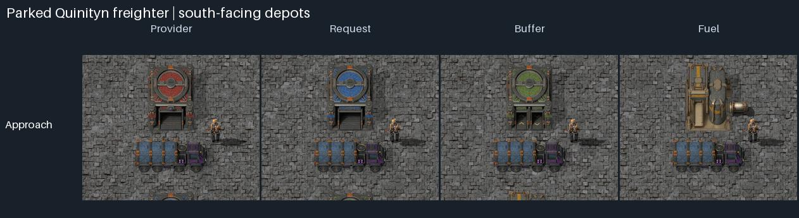
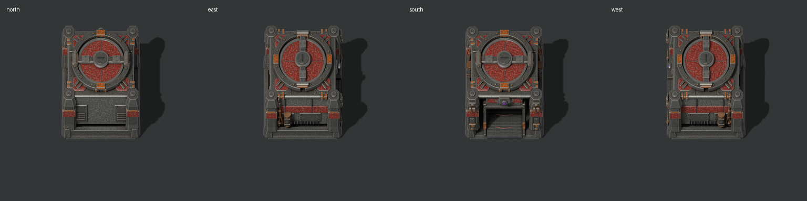
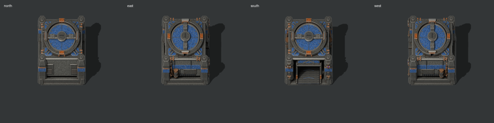
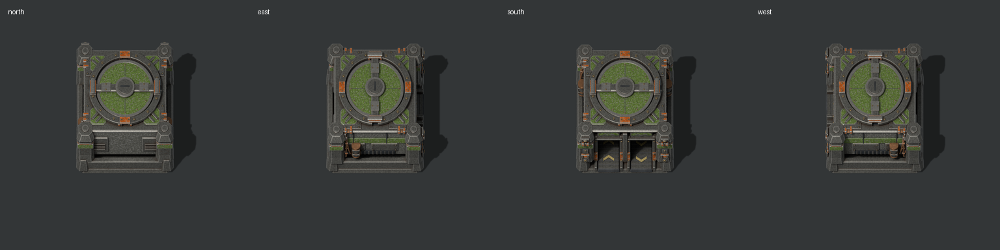
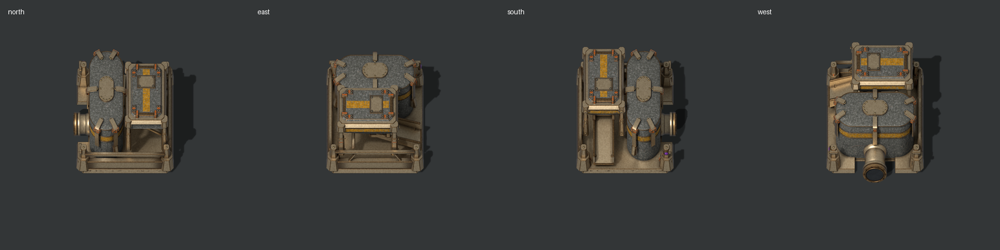
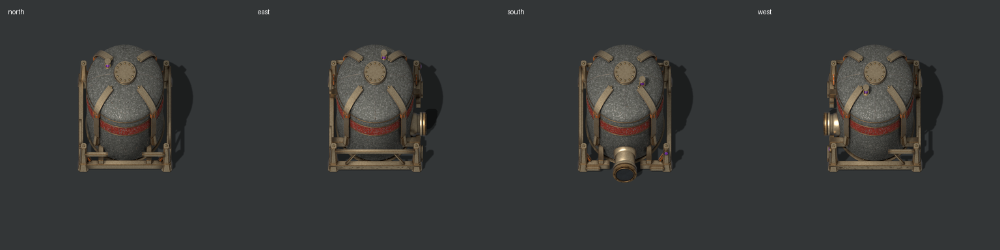
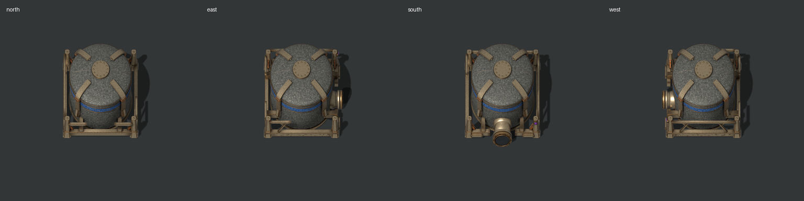
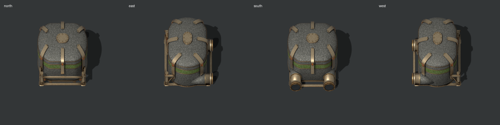
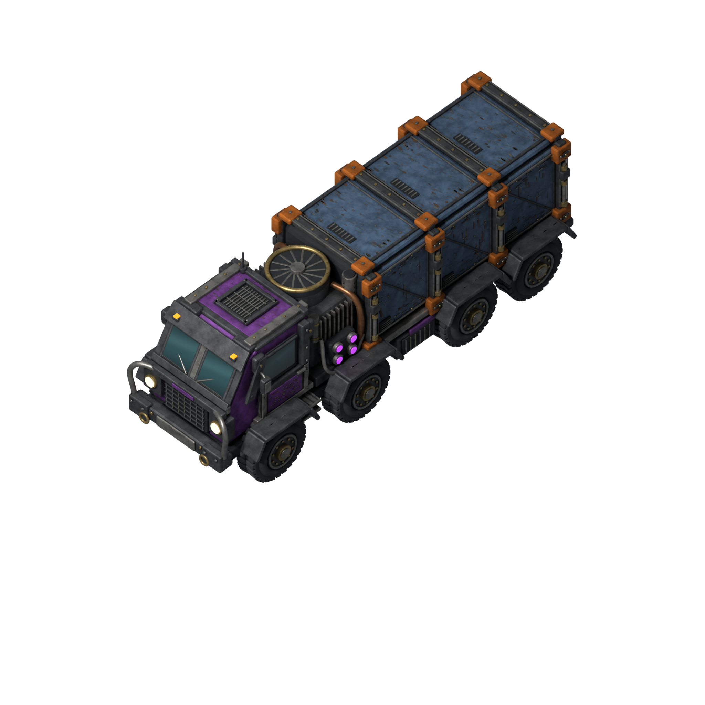

# Jat'z Distribution

**Armored freight trucks that keep your factory supplied by road. A logistics mod for Factorio 2.1.**



Build depots where goods are made and where they're needed, connect them with road, and heavy freighters do the hauling. The gameplay is inspired by Klonan's [Transport Drones](https://mods.factorio.com/mod/Transport_Drones), with trucks in place of drones and a rugged industrial look inspired by the Yuoki mods.

> [!NOTE]
> **In development.** Item and fluid deliveries, and fuel, already work. Real recipes and balance are still to come, and everything is free to craft for now. The mod isn't on the Mod Portal yet: see [Try it](#try-it).

## How it works

1. **Lay road.** Freighters drive only on road, which you'll find in the mod's row of the crafting menu. Each depot lays a road tile under its loading zone (except on space platforms), so just run your road up to it.
2. **Place a provider depot** and fill it with goods.
3. **Place a request depot**, open it, and choose an item and how many to keep in stock.
4. **Give it freighters.** Put freighters in the request depot's freighter slot.
5. **Fuel them.** Freighters come with a full tank and burn fuel as they drive. Place a fuel depot on the road, with any fuel item in it or any burnable fluid piped in (petroleum gas burns for them), and they fill up there by themselves. Hover a freighter to see its fuel.

That's it. Freighters set off for the provider that's nearest **by road**, load up and bring the goods home. A status light on the request depot tells you at a glance if anything is wrong.

Want the details? The **[player guide](docs/guide.md)** covers the freighter slot and its shortcuts, fuel, buffer depots, priority, liquid depots, the circuit network, blueprints, and what happens when a road is cut.

## Features

- **Trucks, not drones:** the Quinityn sealed freighter is an armored eight-wheeler that follows your roads.
- **Smart routing:** freighters pick the nearest provider by road, not in a straight line, and re-route the moment a road is cut.
- **They need fuel, like real trucks:** a freighter low on fuel for where it's going stops at the nearest fuel depot first, fills up, then carries on. Any fuel works, item or fluid, from any mod.
- **Items and fluids:** separate depots for dry cargo and for fluids, and fluids keep their temperature.
- **Buffers and priority:** stage stock close to where it's needed, and rank depots from 1 to 10.
- **Circuit network:** switch depots on and off with a circuit condition, and read what a whole road network holds with the road network monitor.
- **Blueprint friendly:** copy, paste and blueprints keep requests, priorities and freighters, and construction robots bring the trucks.
- **Cargo stays intact:** armor keeps its equipment, and food keeps track of its spoilage.
- **See what's on board:** a freighter's cargo bays are light grey while empty and take the color of the item or fluid it picks up.
- **Paint it your way:** every truck and depot has three paint layers you can recolor.

## The depots

| Depot | What it does | North · East · South · West |
| --- | --- | --- |
| **Provider** | Offers its items to freighters |  |
| **Request** | Keeps an item in stock, fetched by its own freighters |  |
| **Buffer** | Stocks an item from providers, close to where it's needed |  |
| **Fuel** | Freighters fill up here with any fuel item, or any burnable fluid piped in |  |
| **Liquid Provider** | Offers fluids to freighters |  |
| **Liquid Request** | Keeps a fluid in stock, fetched by its own freighters |  |
| **Liquid Buffer** | Stocks a fluid from liquid providers. Two pipe connections |  |

Every depot is 3×3 and can face any direction. A worn "no parking: loading zone" marking shows where freighters load, and fluid ports connect to ordinary pipes.

## The Quinityn freighter



A sealed freight hauler with an armored cab, three clamped cargo bays and an exposed power unit. Chipped paint, scuffs and smoky glass give it a used, industrial look.

**More screenshots:** [every depot in every rotation](docs/images/depots-all-rotations.jpg) · [recoloring each paint layer](docs/images/depots-paint-channels.jpg) · [depots at in-game scale](assets/depots/previews/all-depots-world-scale.png) · [freighter colors](docs/images/freighter-palettes.jpg)

## Try it

Built for **Factorio 2.1** (tested on 2.1.24). It needs only the base game and also works with Space Age.

The mod isn't on the Mod Portal yet, so build it from this repository with Python 3.13:

```sh
python3 tools/package_mod.py
```

Copy `dist/jatz-distribution_0.1.0.zip` into your [Factorio mods folder](https://wiki.factorio.com/Application_directory#User_data_directory) and enable **Jat'z Distribution**. You'll find everything in the Logistics tab of the crafting menu, in the row just above the car and tank.

## Roadmap

- [x] Quinityn freighter and seven depots, with in-game icons
- [x] Roads, and freighter deliveries between provider and request depots
- [x] Buffer depots and priority
- [x] Liquid deliveries
- [x] Fuel for freighters, and refueling at the Fuel depot
- [ ] Freighter wheel animation and final stats
- [ ] Recipes, technology and balance
- [ ] Release on the Factorio Mod Portal

## Credits

- **Gameplay:** inspired by [Transport Drones](https://mods.factorio.com/mod/Transport_Drones) by Klonan.
- **Visual style:** inspired by the Yuoki Industries family of Factorio mods.
- **Road artwork:** the slag path tiles from [Yuoki Industries - Railways](https://github.com/jatmn/Yuoki-Railways-Factorio-2.0), © YuokiTani & others, used under [CC BY-NC-SA 4.0](https://creativecommons.org/licenses/by-nc-sa/4.0/).

Apart from the road art, the models and sprites are original work built in Blender. The concept art and design references are in [concepts/](concepts/README.md).

## License

Jat'z Distribution is licensed under the [GNU LGPL v3.0](COPYING.LESSER), the same license as Transport Drones. You're welcome to use, modify and share it, including in modpacks; modified versions you share must stay under the LGPL-3.0, with their source available and these notices intact.

The road artwork in `assets/roads/yuoki-railways/` keeps its own CC BY-NC-SA 4.0 licence, so it can't be used commercially, and changed versions of it must be shared under the same licence. The in-game screenshots also show Factorio's own artwork, which remains Wube Software's. See [NOTICE](NOTICE) for the full details and attributions; the GPL text the LGPL builds on is in [COPYING](COPYING).

## Contributing

<details>
<summary>Repository layout and test commands</summary>

| Folder | Contents |
| --- | --- |
| `info.json`, `data.lua`, [`prototypes/`](prototypes/), `control.lua`, [`scripts/`](scripts/), [`locale/`](locale/) | The mod itself. The repository root is the mod's root, so it uses the sprite helpers and sheets in `assets/` directly. |
| [`assets/quinityn-freighter/`](assets/quinityn-freighter/README.md) | Freighter Blender model, game sprites, Lua helper and render tools |
| [`assets/depots/`](assets/depots/README.md) | Depot Blender models, pipe connector, game sprites, Lua helpers and render tools, plus the archived 1×1 depots |
| [`assets/roads/`](assets/roads/README.md) | The road tile art, from Yuoki Industries - Railways (CC BY-NC-SA 4.0) |
| [`concepts/`](concepts/README.md) | Approved concept art for the depots, with links to the freighter concept |
| [`tests/factorio/`](tests/factorio/) | Test mods that check the mod and the artwork in Factorio |
| [`tools/`](tools/) | Mod packager, test runners and CI tools |
| [`docs/`](docs/) | [Player guide](docs/guide.md), [testing guide](docs/testing.md), [test results](docs/test-results.md) and README images |

Each asset folder's README explains its files, how to use the sprites in Factorio, and how to edit and re-render the models. Start with [CONTRIBUTING.md](CONTRIBUTING.md) and read [AGENTS.md](AGENTS.md) before changing anything; it holds the project rules for human and AI contributors. Report vulnerabilities privately using [SECURITY.md](SECURITY.md).

You need Python 3.13 and Factorio 2.1; the free [headless server](https://factorio.com/download) is enough for the automated checks. Blender 4.3.2 is only needed to edit models and re-render sprites.

```sh
python3 tools/test_mod.py --factorio /path/to/factorio/bin/x64/factorio     # the mod: craft, place, rotate, drive, deliver
python3 -m venv .venv
.venv/bin/python -m pip install -r requirements.txt
.venv/bin/python assets/quinityn-freighter/tools/validate_assets.py
python3 tools/test_factorio.py --factorio /path/to/factorio/bin/x64/factorio
python3 tools/test_depot_art.py --factorio /path/to/factorio/bin/x64/factorio
```

</details>
