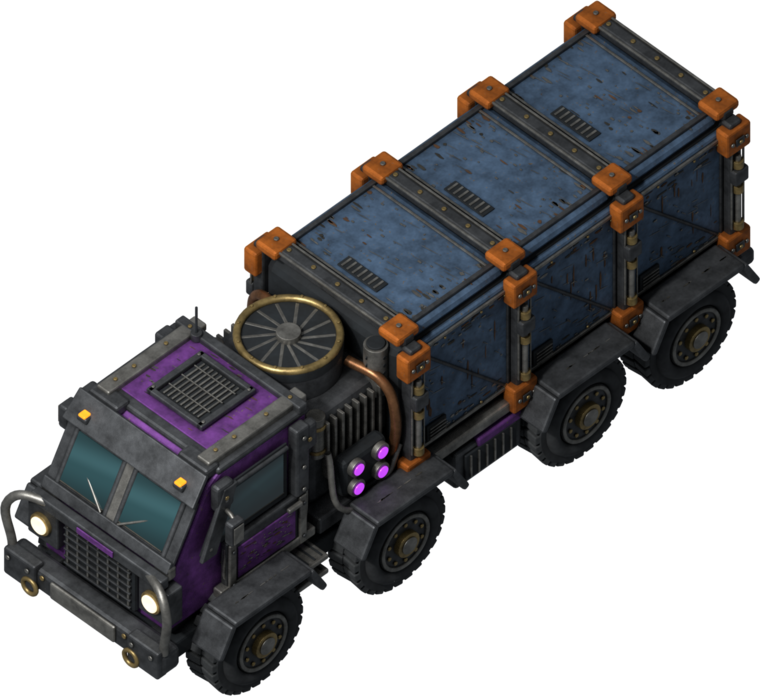
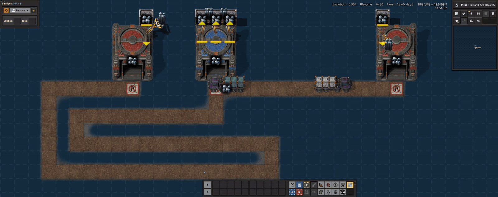
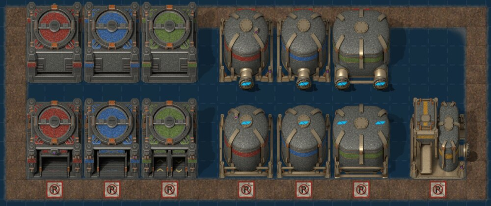
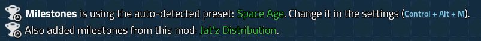

# Jat'z Distribution

[](portal/images/quinityn-freighter.png)

**Heavy freighters. Your roads. A factory that supplies itself.**

Build depots where goods are made and where they're needed, lay road between them, and armored **Quinityn freighters** do the hauling. Jat'z Distribution is a road logistics system for **Factorio 2.1**, inspired by Klonan's [Transport Drones](https://mods.factorio.com/mod/Transport_Drones) and rebuilt around big trucks, big loads and big factories.

- **Request** an item or fluid at a depot, and freighters fetch it from the provider that's nearest **by road**.
- **Haul** two stacks of items or 750 fluid a trip from the start, and up to 12 stacks or 4,500 fluid with research.
- **Fuel** your fleet with any fuel item or burnable fluid. Freighters top up at fuel depots on their own.
- **Scale** to hundreds of depots and thousands of freighters, with the work spread evenly over every second.
- **Run over** the biters in your way. Freighters don't stop for anything.

[](portal/images/jatz-distribution-in-game.gif)

*87 seconds in game, uncut: a request depot sends its freighters along the road to the provider depots, they load and bring the goods home, and the depots' panels show what's going on. Watch which provider they pick: distance is measured along the road, not in a straight line. The provider on the left looks closer, but its road winds a long way round, so the freighters head for the one the road reaches sooner. Click for full size. It's a large animation, so give it a moment to load.*

**[Get it on the Mod Portal](https://mods.factorio.com/mod/jatz-distribution)** · **[Player guide](docs/guide.md)** · **[Report a bug](https://github.com/jatmn/jatz-distribution/issues)**

[](https://ko-fi.com/jatmn)

---

## Coming from Transport Drones?

You'll feel at home: roads, provider and request depots, buffers, fluids and fuel all work the way you expect. Here is what's different.

**Not a drop-in replacement.** Jat'z Distribution is its own mod, not an update or fork of Transport Drones, and the two can't be enabled together. Nothing is migrated: Transport Drones' roads, depots, drones and their settings don't turn into ours. If you remove Transport Drones from a save, Factorio deletes everything it placed, along with the items stored in its depots, so empty them first and plan to rebuild your network with our depots and road. Back up your save before switching.

| | Transport Drones | Jat'z Distribution |
| --- | --- | --- |
| **The vehicle** | Small drones | The Quinityn freighter: an armored eight-wheel truck, rendered in 64 directions |
| **Load per trip** | 1 stack (or 500 fluid) to start | **2 stacks** (or 750 fluid) to start, up to 12 stacks (or 4,500 fluid) with research |
| **Fuel** | Delivered to each request depot, which fuels its drones | **Each freighter carries its own tank** and stops at the nearest fuel depot by road when it runs low. Nothing has to deliver fuel to your request depots |
| **What burns** | One fuel fluid, petroleum gas by default | **Any fuel item or burnable fluid**, from any mod: coal, solid fuel, rocket fuel, petroleum gas and more |

**Built for megabases.** On the project's stress map (600 depots and over 16,000 vehicles across three surfaces, both mods at default settings on the same PC), Jat'z Distribution took **1.5 ms a tick** against Transport Drones 2.1.4's 21.8 ms, and delivered **almost three times as many items a minute** with an eighth as many vehicles on the road. [See the benchmark and how it was run](docs/benchmark.md).

**And on top of that:**

- **Cargo you can read at a glance.** A freighter's cargo bays are light grey while empty, then take the color of what it picked up: copper orange, sulfur yellow, water blue. In alt mode, loaded freighters show their cargo's icon.
- **Cargo stays intact.** Armor keeps its equipment and food keeps track of its spoilage on the way.
- **You choose who supplies whom.** Rank provider and buffer depots from 1 to 10, and decide per depot whether buffers or providers come first. A startup setting lets buffers pull from lower-priority buffers, to gather stock centrally.
- **Road tunnels.** Like underground belts for your roads: freighters drive in at one end and come out at the other, under whatever stands between.
- **Circuit control built in.** Switch provider, request and buffer depots on or off with a circuit condition that reads the network or just the depot's own contents. The **road network monitor** reads what a whole road network holds, or what its request depots still need.
- **See your whole network.** The **Freighter network** button on the shortcut bar shows your freighters and depots, and every item and fluid: what your depots hold, how many request it, and what is still needed. With Space Age, pick a planet or platform.
- **Robots welcome, if you want them.** Tick a box to let logistic robots use a provider depot as a passive provider chest, or a buffer depot as a buffer chest.
- **Losses replace themselves.** A request depot that loses a freighter asks construction robots for a new one.
- **Blueprint everything.** Copy and paste and blueprints keep requests, priorities, circuit conditions and freighter counts, and construction robots bring the trucks.

---

## The depots

Every depot is 3×3, can face any direction, and has a worn "no parking: loading zone" marking where freighters load. Building one lays a road tile under that marking, so you only need to run your road up to it.

[](portal/gallery/01-depots-on-road.png)

*Top row turned north, bottom row facing south with their loading zone markings. Click for full size.*

| Depot | What it does |
| --- | --- |
| **Provider** (red) | Offers its items to freighters |
| **Request** (blue) | Keeps an item in stock. Holds up to 100 freighters of its own |
| **Buffer** (green) | Stocks an item from providers, close to where it's needed |
| **Fuel** (amber) | Freighters fill up here with any fuel item, or any burnable fluid piped in |
| **Liquid provider** | Offers fluids to freighters |
| **Liquid request** | Keeps a fluid in stock. Fluids keep their temperature on the way |
| **Liquid buffer** | Stocks a fluid from liquid providers. Two pipe connections |

Every depot takes red and green wires. Item depots and the fuel depot have 48 slots, and liquid depots connect to ordinary pipes and hold 25,000 fluid. You can change the slots of each item depot and of the fuel depot, and the tanks of liquid provider, liquid request, liquid buffer and fuel depots, in the startup settings.

Request and buffer depots replace each other in place, as chests do: build one over the other, or use an upgrade planner, and it keeps its stock, request and freighters.

**More pictures:** [the freighter with its depots](docs/images/depots-with-freighter.jpg) · [every depot in every rotation](docs/images/depots-all-rotations.jpg) · [recoloring each paint layer](docs/images/depots-paint-channels.jpg) · [freighter colors](docs/images/freighter-palettes.jpg) · [freighters driving](docs/images/freighter-driving.jpg) · [the Mod Portal gallery](portal/gallery/)

---

## Up and running in five steps

1. **Research Freight system** (after Engine, with red and green science).
2. **Lay road.** Freighters drive only on road, which you craft like stone path.
3. **Place a provider depot** and fill it with goods.
4. **Place a request depot**, open it, choose an item and how many to keep in stock, and put freighters in its freighter slot.
5. **Place a fuel depot** on the road and load it with coal or any other fuel.

That's it. Freighters set off, load up and bring the goods home. A status light on each request depot shows at a glance whether anything is wrong, and hovering it tells you what. The **[player guide](docs/guide.md)** covers everything else.

---

## Recipes and research

**Freight system** (after Engine, 200 × red and green) unlocks the item and fuel depots, the freighter and road. **Liquid freight**, **Road network monitor** and **Road tunnels** follow, and upgrades make freighters faster (with infinite levels) and carry up to 12 stacks or 4,500 fluid. Every recipe uses things you can already make when its research finishes. The [Mod Portal page](https://mods.factorio.com/mod/jatz-distribution) shows each recipe, and the [player guide](docs/guide.md#research) has the research tree.

---

## Fuel that works like fuel

- A new freighter comes with a full tank: 20 MJ, about 2,000 tiles of driving.
- Before each leg of a trip it checks its tank against the road ahead. If it's short, it **re-routes to the fuel depot nearest by road**, fills up, then carries on, cargo and all.
- One that runs dry anyway crawls on at a tenth of its speed, so it's never stranded.

**Where you put fuel depots matters.** Put them along the routes your freighters already drive, near busy depots: a fuel depot across the map ties up every freighter that runs low. The [player guide](docs/guide.md#fuel) has the details.

---

## Compatibility

- **Space Age:** optional. Adds the carbon freighter recipe. Depots don't lay road on space platforms.
- **Quality:** optional. Requests can name a quality, compare qualities or take any quality, whatever the quality of the depots and freighters carrying them. Better freighters carry more, drive faster and hold more fuel; better depots hold more. Changing a depot's quality keeps its settings and freighters; its request stays within what the new depot holds.
- **[Mining Drones](https://mods.factorio.com/mod/Mining_Drones)**, **[Mining Drones 2 Remastered](https://mods.factorio.com/mod/Mining_Drones_Remastered)** and **[Mining Drones Mod](https://mods.factorio.com/mod/Mining_Drones_Mod)**: every mining depot becomes a provider depot for whatever its drones mine.
- **[Milestones](https://mods.factorio.com/mod/Milestones):** tracks your first freighter, 100 freighters and 1,000 road, whichever preset you use.

  
- **Overhaul mods:** cargo colors come from game data, not a fixed list, so most items from overhauls such as Bob's and Angel's get a color too. Mods can also declare their items' colors themselves (see below).
- **Not compatible** with Transport Drones or its forks, since they do the same job. Factorio won't let you enable them together.

---

## For mod authors: cargo colors

Factorio items have no color of their own, so Jat'z Distribution works out each item's cargo color from game data: its ore's map color, the fluid in a barrel, or a recipe that makes it. That covers most items, but not all. A by-product that no recipe makes on its own gets the truck's plain slate blue, and an item made from many unrelated materials takes the color of whichever recipe comes first.

Your mod can declare its items' colors instead. Jat'z Distribution uses a declared color before any of its own rules, and items made from that item follow it. Add a `mod-data` prototype with `data_type = "item-colors"`:

```lua
-- data.lua (or data-updates.lua) of your mod
data:extend({
  {
    type = "mod-data",
    name = "my-mod-item-colors", -- any unique name
    data_type = "item-colors",
    data = {
      items = {
        ["my-slag"] = { r = 0.55, g = 0.36, b = 0.17 },
        ["my-crystal"] = { r = 0.25, g = 0.62, b = 0.84 },
      },
    },
  },
})
```

- **Colors** are ordinary Factorio colors: `{ r, g, b }` or `{ 0.5, 0.2, 0.8 }`, from 0 to 1, or 0 to 255 if any value is above 1. Alpha is ignored, and a value that isn't a table is skipped.
- **When to declare:** in `data.lua` or `data-updates.lua`. Jat'z Distribution reads the colors in its `data-final-fixes.lua`, which may run before yours.
- **No dependency needed.** Without Jat'z Distribution the prototype is simply unused, and other mods can read the same `item-colors` data.
- **Several mods** may declare colors. Prototypes are read in name order, and the first one to name an item wins.
- **Fluids** already have a color, their `base_color`, so they need nothing.
- **Painting:** freighters are painted from a fixed palette of 216 colors (each channel in steps of 0.2), so close colors share a paint.

For an example, [Yuoki Industries is adding a declaration for all its items](https://github.com/jatmn/Yuoki-Factorio-2.x/pull/34), with colors read from their icons by a small generator script.

---

## Install

Built for Factorio **2.1** (tested on 2.1.24). Only the base game is needed; Space Age and Quality are optional.

Install **Jat'z Distribution** from the in-game mod browser (**Mods → Install**), or download it from the [Factorio Mod Portal](https://mods.factorio.com/mod/jatz-distribution). You'll find everything in the crafting menu's Logistics tab, in the row just above the car and tank.

**Before you play**

- This is an **early release**. Balance may still change between versions, so **read the [changelog](changelog.txt) before updating** and back up your saves.
- Bug reports and feedback are welcome on [GitHub](https://github.com/jatmn/jatz-distribution/issues) or in the Mod Portal's Discussion tab.

To try the latest changes from `main` instead, build the mod from this repository with Python 3.13:

```sh
python3 tools/package_mod.py
```

Then copy the zip from `dist/` into your [Factorio mods folder](https://wiki.factorio.com/Application_directory#User_data_directory) and enable it in place of the Mod Portal version.

---

## Credits

- **Gameplay:** inspired by [Transport Drones](https://mods.factorio.com/mod/Transport_Drones) by Klonan.
- **Visual style:** inspired by the Yuoki Industries family of mods. The freighter and depots are original models built in Blender for this mod; the concept art and design references are in [concepts/](concepts/README.md).
- **Road artwork:** the slag path tiles from [Yuoki Industries - Railways](https://github.com/jatmn/Yuoki-Railways-Factorio-2.0), © YuokiTani and others, used under [CC BY-NC-SA 4.0](https://creativecommons.org/licenses/by-nc-sa/4.0/).
- Made by **jatmn**. Enjoying it? [Support jatmn on Ko-fi](https://ko-fi.com/jatmn).

## License

Jat'z Distribution is licensed under the [GNU LGPL v3.0](COPYING.LESSER), the same license as Transport Drones. You're welcome to use, modify and share it, including in modpacks; modified versions you share must stay under the LGPL-3.0, with their source available and these notices intact.

The road artwork in `assets/roads/yuoki-railways/` keeps its own CC BY-NC-SA 4.0 licence, so it can't be used commercially, and changed versions of it must be shared under the same licence. The in-game screenshots also show Factorio's own artwork, which remains Wube Software's. See [NOTICE](NOTICE) for the full details and attributions; the GPL text the LGPL builds on is in [COPYING](COPYING).

---

## Contributing

Start with [CONTRIBUTING.md](CONTRIBUTING.md), and read [AGENTS.md](AGENTS.md) before changing anything: it holds the project rules for human and AI contributors, and links the [design notes](docs/design/) for each part of the mod. Report vulnerabilities privately using [SECURITY.md](SECURITY.md).

| Folder | Contents |
| --- | --- |
| `info.json`, `settings.lua`, `data.lua`, `data-final-fixes.lua`, [`prototypes/`](prototypes/), `control.lua`, [`scripts/`](scripts/), [`locale/`](locale/), [`migrations/`](migrations/) | The mod itself. The repository root is the mod's root, so it uses the sprite helpers and sheets in `assets/` directly |
| [`assets/quinityn-freighter/`](assets/quinityn-freighter/README.md) | Freighter Blender model, game sprites, Lua helper and render tools |
| [`assets/depots/`](assets/depots/README.md) | Depot, road network monitor and road tunnel Blender models, pipe connector, wrecks, game sprites, Lua helpers and render tools, plus the archived 1×1 depots |
| [`assets/roads/`](assets/roads/README.md) | The road tile art, from Yuoki Industries - Railways (CC BY-NC-SA 4.0) |
| [`concepts/`](concepts/README.md) | Approved concept art for the depots, with links to the freighter concept |
| [`docs/`](docs/) | [Player guide](docs/guide.md), [design notes](docs/design/), [runtime states](docs/runtime-state.md), [testing](docs/testing.md), [test results](docs/test-results.md), [UPS benchmark](docs/benchmark.md), [releases](docs/releases.md) and README images |
| [`portal/`](portal/README.md) | The Mod Portal page: summary, description and screenshots, synced by each release. This README follows it |
| [`tests/`](tests/) | Lua test harnesses and the Factorio test mods |
| [`tools/`](tools/) | Mod packager, test runners, UPS benchmark and CI tools |

You need Python 3.13 and Factorio 2.1; the free [headless server](https://factorio.com/download) is enough for the automated checks. Blender 4.3.2 is only needed to edit models and re-render sprites. [docs/testing.md](docs/testing.md) has the full list of checks.

```sh
python3 tools/test_mod_setup.py                                             # Lua harnesses and setup checks, no Factorio needed
python3 tools/test_mod.py --factorio /path/to/factorio/bin/x64/factorio     # the mod in Factorio: craft, place, drive, deliver
python3 -m venv .venv
.venv/bin/python -m pip install -r requirements.txt
.venv/bin/python assets/quinityn-freighter/tools/validate_assets.py
python3 tools/test_factorio.py --factorio /path/to/factorio/bin/x64/factorio     # freighter artwork
python3 tools/test_depot_art.py --factorio /path/to/factorio/bin/x64/factorio    # depot artwork
```
