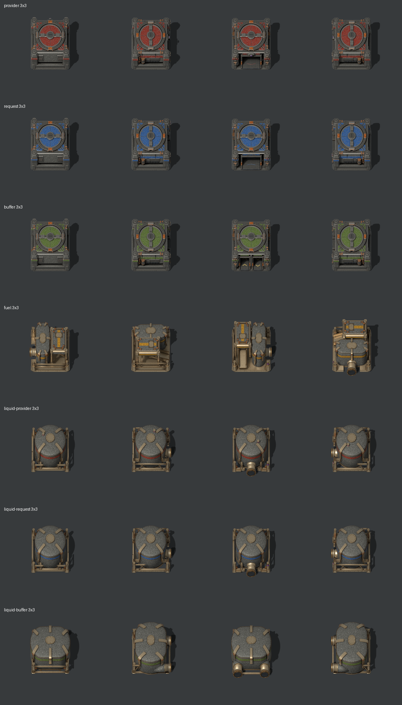

# Depots



Seven 3×3 depot buildings: Provider, Request, Buffer, Fuel, Liquid Provider, Liquid Request and Liquid Buffer. Each one is rendered from an editable Blender model in four directions (north, east, south, west), with three tintable paint layers and a separate ground shadow. The four fluid designs use a shared pipe connector that lines up with vanilla Factorio pipes.

## Files

| Path | Contents |
| --- | --- |
| `source/<role>-3.blend` | **The editable models**, one per depot. Open these in Blender to make changes. |
| `source/pipe-connector.blend` | Editable model of the shared exterior pipe connector |
| `<role>/3/sheets/` | **Game sprites.** 2048×512 atlases (north, east, south, west) for `base`, three paint masks, `shadow` and a default-color `preview` |
| `<role>/3/masters/hero-default-palette.png` | 2048px presentation render |
| `loading-zone/loading-zone.png` | The 1×1 loading zone ground marking (64 px, drawn at scale 0.5). It's drawn by `tools/make_loading_zone.py`, which is its source; `loading-zone.json` records both hashes |
| `icons/<role>-depot.png` | In-game icons: each depot facing south, taken from the south frame of its `sheets/preview.png` by `tools/make_icons.py`. 64 px with three custom mipmaps (120 × 64); `icons/icons.json` records their sources |
| `technology/liquid-provider-depot.png` | Technology icon (Liquid freight research): the liquid provider depot's south frame at 256 px, no mipmaps, made by `tools/make_icons.py`; `technology/icons.json` records its source |
| `<role>/3/previews/four-directions.png` | Four-direction preview strip |
| `<role>/3/asset.json` | Palette, scale, pipe-port positions and source model |
| `connectors/sheets/` | Connector game sprites and shadow |
| `connectors/frames/` | Individual connector frames, used by the preview and packaging tools |
| `connectors/validation.json` | Connector registration data. **Tools read this file**, so keep it. |
| `factorio/` | Lua helpers for depot pictures and pipe pictures, plus generated definitions |
| `previews/` | All depots in a grid, all depots at in-game scale, and `recolor.html`, a recoloring viewer you open in a browser |
| `tools/` | Builders, renderers, packagers, geometry inspectors and preview generator |
| `archive/1x1/` | Retired 1×1 versions of all seven depots; see its [README](archive/1x1/README.md) |
| `*validation.json` | Results from the most recent geometry, junction and packaging checks |

Roles are `provider`, `request`, `buffer`, `fuel`, `liquid-provider`, `liquid-request` and `liquid-buffer`.

The 1×1 **road network monitor** (`road-monitor/1/`, `source/road-monitor-1.blend`) is built, rendered and packaged with the same tools, in the liquid depots' finish: grey housing like their tank shells, bronze skid, lid rim and strap, and a brown band (`MONITOR_PALETTE` in `build_depots.py`), with two terminal posts for its wires and a status lens on its lid. The builder records in its `asset.json` where the wires meet the posts, their shadows and the lens for each direction (`points`); `prototypes/road-monitor-points.lua` copies them, and `tools/test_mod_setup.py` checks the copy. The mod draws its `preview` and `shadow` sheets. Its icon, `icons/road-monitor.png`, shows it facing north, as it is placed. It has no loading path or pipes, so the geometry and junction inspectors skip it.

## Paint layers

The packaging pipeline is shared with the freighter, so the files keep the freighter's mask names:

| File | Palette field | Painted parts |
| --- | --- | --- |
| `mask-cab` | `role` | Identification belts and roof panels (red, blue, green or amber by default) |
| `mask-trim` | `clamps` | Retention clasps and brackets |
| `mask-cargo` | `housing` | Cargo walls and tank shells |

Masks are neutral grayscale with alpha, so any tint color works. Bare metal, copper, brass, rubber, paint chips, gauges and lenses stay in `base` and are never tinted. Draw the layers in this order: shadow, base, role, clamps, housing. All layers share one canvas and ground pivot.

## Using it in Factorio

**In Jat'z Distribution**, every depot placed unrotated has its loading zone to the south (`prototypes/orientation.lua`):
- Provider, Request, Buffer and Fuel load through an opening at their front, so the mod shows their `south` artwork by default and turns their pipe ports with it. The Fuel depot's port is then on the east.
- The liquid depots keep their pipes to the north and load from the opposite, south side.
- The loading zone marking is the depot's `integration_patch`, drawn on the `decals` layer one tile beyond the footprint. It rotates with the depot, shows on ghosts and disappears with it.

The rest of this section describes the helpers for any mod, using the artwork's own direction names.

Copy each depot's `sheets/` into your mod as `graphics/depots/<role>/3/`, copy `connectors/sheets/` to `graphics/depots/connectors/`, and copy the three Lua files from `factorio/` into its prototypes. To keep the sheets somewhere else, pass their location: `pictures(...)` takes an optional fifth argument, a `string.format` pattern for (role, size) such as `"assets/depots/%s/%d/sheets/"`, and `pipe_pictures(mod_name, directory)` takes the connector folder. Jat'z Distribution itself does this; see `prototypes/depots.lua`. Then:

```lua
local pictures = require("prototypes.depot-pictures")
local sprite = pictures("your-mod", "liquid-provider", 3, {
  role = {0.6, 0.1, 0.2},
  clamps = {0.8, 0.6, 0.2},
  housing = {0.4, 0.5, 0.6}
})
```

For fluid depots, add the connector helper inside each `fluid_box`:

```lua
local pipe_pictures = require("prototypes.depot-pipe-pictures")
-- pipe_picture = pipe_pictures("your-mod"),
-- secondary_draw_orders = {north = -1},
-- pipe_covers = pipecoverspictures(),
```

- **Scale:** 0.46875 for the building (512px frames) and 0.15625 for the connector. Pivot is the ground center with zero shift.
- **Pipe ports** (unrotated, in Factorio tile coordinates; they turn with the building):

  | Depot | Port | Faces |
  | --- | --- | --- |
  | Fuel | (−1, 0) | West |
  | Liquid Provider, Liquid Request | (0, −1) | North |
  | Liquid Buffer | (−1, −1) and (1, −1) | North |

- **Connector origin:** `pipe_picture` draws from the neighboring pipe's center. The Lua helper already corrects for this. Don't remove that correction or apply the building's scale to it.
- The artwork test fixture in `tests/factorio/depot-art-check_0.1.0` is a complete working example using containers and storage tanks.

## Editing a model

You need Blender 4.3.2, whose Python must include NumPy, plus Python 3.13 with the packages in the repository's `requirements.txt`.

Open `source/<role>-3.blend`. Things to preserve:

- **`Depot | rotate this assembly`** holds the building and rotates it through 0°, 90°, 180° and 270°.
- **`PROJECTION | tile grid compensation`** stretches world Y by √2 so ground tiles project evenly. Keep it above the rotating assembly.
- **The camera** is fixed: orthographic, 45° elevation, scale 7.5. One Blender unit is one game tile, and the model faces +Y (north).
- **`SOCKET` empties** mark the pipe ports. Pipes must visibly reach the tank.
- **Pipe shape keys and drivers** keep the pipe diameter and seam matched to vanilla pipes in every direction. They read the assembly rotation, so preserve them when editing tanks or pipe routes.
- **Paint materials** feed the role, clamp and housing coverage outputs. Wear lives in the untinted materials.

`tools/build_depots.py` rebuilds the models from scratch, but it **overwrites** the `.blend` files. If you edit a file by hand, either carry the change into the builder or don't run it. Use `--role fuel` (for example) to limit a build or render to one depot.

## Re-rendering the sprites

Rendering creates EXR masters, PNG layers and frames under each `<role>/3/masters/` and `<role>/3/frames/`. These are regenerated and not stored in Git. Run from the repository root:

```sh
T=assets/depots/tools
blender -b --python-exit-code 1 --python $T/build_depots.py -- --size 3   # only if rebuilding from the builder
blender -b --python-exit-code 1 --python $T/inspect_depots.py
blender -b --python-exit-code 1 --python $T/inspect_junctions.py
python3 $T/render_depots.py            # add --role <role> for one depot
python3 $T/package_depots.py           # add --role <role> to package one, keeping the others' records
python3 $T/create_preview.py
.venv/bin/python tools/make_icons.py   # the icons are made from the packaged sprites
```

The road network monitor alone:

```sh
blender -b --python-exit-code 1 --python $T/build_depots.py -- --role road-monitor --size 1
python3 $T/render_depots.py --role road-monitor
(cd $T && ../../../.venv/bin/python package_depots.py --role road-monitor)
.venv/bin/python tools/make_icons.py
```

Then copy the new `points` from `road-monitor/1/asset.json` into `prototypes/road-monitor-points.lua`.

After changing the pipe connector:

```sh
blender -b --python-exit-code 1 --python $T/build_connector.py   # only if rebuilding from the builder
blender -b assets/depots/source/pipe-connector.blend --python-exit-code 1 --python $T/render_connector.py
python3 $T/package_connector.py
python3 $T/check_connector_registration.py
```

- `render_depots.py` runs two Blender processes with six threads each, at 2048px and 64 samples. It records the model's hash in a local `masters/render-inputs.json`. If the model has changed since an earlier local render, it stops. Delete that depot's local `masters/exr`, `masters/shadow-silhouettes`, `masters/layers`, `frames` and `masters/render-inputs.json`, then run it again.
- The presentation render is only created when `masters/hero-default-palette.png` is missing. Delete it to get a new one.
- `inspect_depots.py` checks footprints, port positions, loading paths and belt heights. `inspect_junctions.py` checks that every pipe seats into its tank at the native diameter with no clipping in any direction. `package_depots.py` checks the masks, frame edges and atlas contents.
- Optional quick check before a full render: `render_mask_probe.py` (in Blender) followed by `check_mask_probe.py` makes low-resolution renders of all 28 views to catch hidden paint areas.

Afterwards, test in game; see [docs/testing.md](../../docs/testing.md).

## Not yet implemented

These are static loading-state sprites. Moving belts and shutter animation are not drawn. In the mod, freighters already carry items from provider to request depots (`scripts/logistics.lua`); fluid transfer, buffer and fuel depot gameplay, and the Fuel depot's combined solid and liquid inventory are still to come. Native tank ports are two-way.
