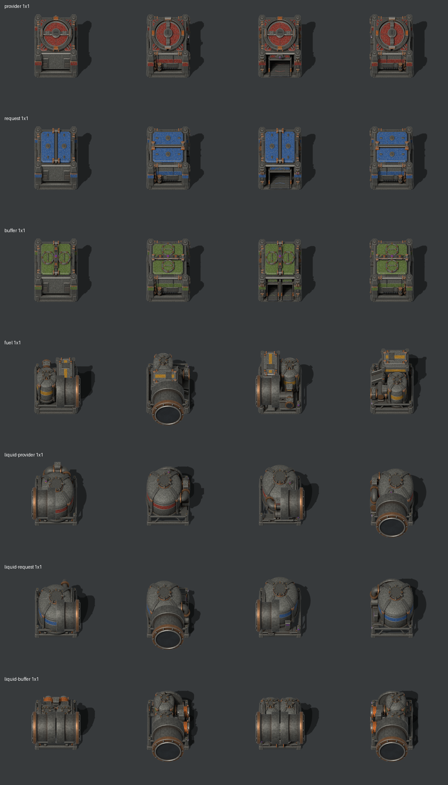

# Archived 1×1 depots

Small 1×1 versions of all seven depots, built at one-third of the 3×3 scale. They are retired from active work: the current tools and test fixtures ignore this folder. They're kept so small depots can be revived later.

## What's here

| Path | Contents |
| --- | --- |
| `source/<role>-1.blend` | Editable 1×1 Blender models |
| `<role>/1/sheets/` | Game sprite atlases (north, east, south, west) |
| `<role>/1/previews/four-directions.png` | Four-direction preview strip |
| `<role>/1/asset.json` | Palette, scale and pipe-port positions |
| `<role>/1/validation.json` | Packaging check results from when they were made |
| `tools/` | The builder, packager and preview script versions that produced these files |
| `manifest.json` | SHA-256 hashes of the files above |

These files are unchanged from commit `52fdea02f6a196a2228fe8ad31d2bf4c9255d57a`. Their render intermediates (EXR masters, PNG layers, shadows and frames) were removed from this repository. They can be regenerated from the `.blend` files, and the originals are in the `jatz-distribution-archive` repository at that commit.

## Reviving them

Paths inside `asset.json` are relative to the old `assets/depots/` folder, and the archived tools expect that layout. Work in a separate branch: copy the files back into place there, then reconcile them with the current 3×3 tools. Never copy archived files over the active 3×3 artwork. Known defects from when they were retired have not been fixed.
