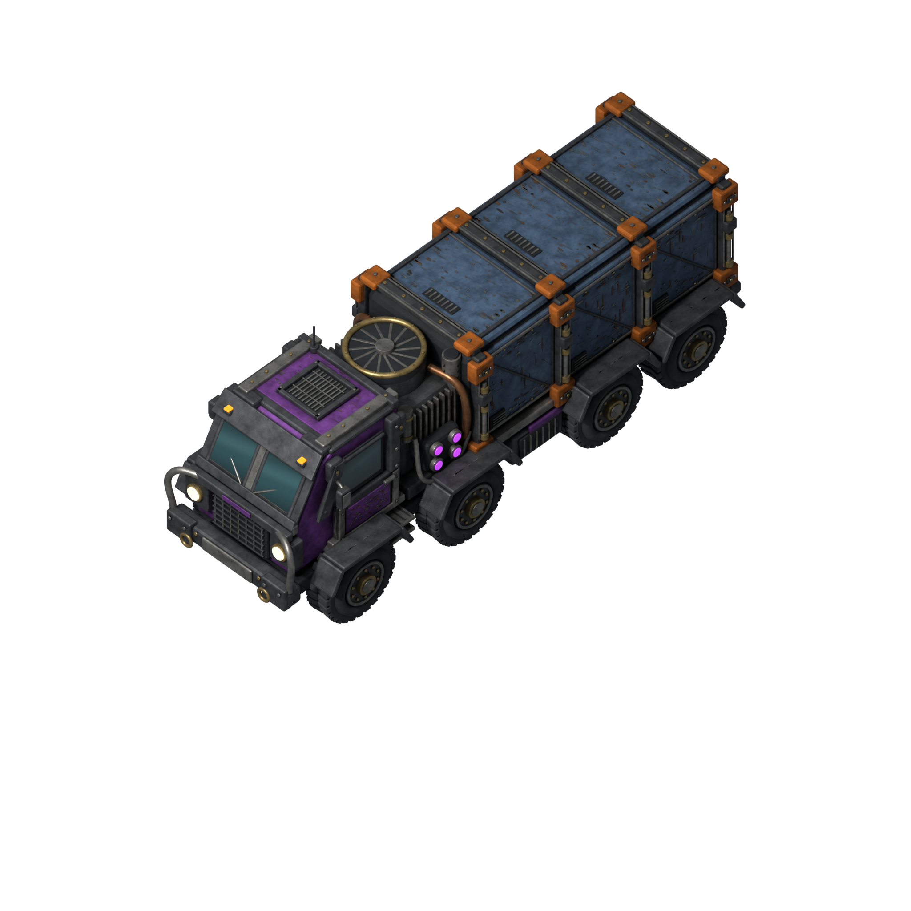

# Quinityn sealed freighter



An armored eight-wheel freight truck with three cargo bays and an exposed power unit. The sprites are rendered from an editable Blender model in 64 directions, with three tintable paint layers and a matching ground shadow.

## Files

| Path | Contents |
| --- | --- |
| `source/quinityn-freighter.blend` | **The editable model.** Open this in Blender to make changes. |
| `source/approved-concept.png` | The approved concept art the model is based on. Keep it unchanged. |
| `source/modeling-turnaround.png` | AI-generated front/back/side/top reference used to model unseen surfaces |
| `source/*-prompt.txt` | Prompts used to generate the two images above |
| `sheets/` | **Game sprites.** 4096×4096 atlases of 512×512 frames: `base`, three paint masks, `shadow`, and a default-color `preview` |
| `factorio/freighter-animation.lua` | Lua helper that builds the layered `RotatedAnimation` |
| `masters/hero-default-palette.png` | 2048px presentation render |
| `icons/quinityn-freighter.png` | In-game icon: the freighter heading south-east, frame 24 of `sheets/freighter-preview.png`, made by `tools/make_icons.py`. 64 px with three custom mipmaps (120 × 64); `icons/icons.json` records its source |
| `../../thumbnail.png` (repository root) | Mod thumbnail for the in-game mod browser and the mod portal: the icon's frame at 144 × 144 px, made by `tools/make_icons.py` |
| `technology/quinityn-freighter.png` | Technology icon (Freight system, speed and item capacity research): the same frame at 256 px, no mipmaps, made by `tools/make_icons.py`; `technology/icons.json` records its source |
| `previews/` | 64-direction contact sheet, turntable animation, per-layer compass sheets, fan clearance check and `recolor.html`, a recoloring viewer you open in a browser |
| `asset.json` | Default palette, scale and render settings |
| `tools/` | Model builder, render driver and renderer, packager, preview generator and validators |
| `*-validation.json`, `checksums.json` | Results from the most recent validation run |

## Paint layers

| Layer | Covers | Default color |
| --- | --- | --- |
| `base` | Steel frame, tires, copper, brass, glass, lamps, violet power lenses, fasteners and wear. Never tinted. | none |
| `mask-cab` | Cab paint and small lower chassis strips | Violet |
| `mask-trim` | Cargo corner clamps and roof clamps | Orange |
| `mask-cargo` | Cargo side and roof panels and rear doors | Slate blue |
| `shadow` | Ground shadow, softened, at 45% opacity | none |

The masks are neutral grayscale (equal R, G and B) with alpha, so any tint color works. Chips, rust and exposed metal stay in `base` and survive recoloring. Draw the layers in this order: shadow, base, mask-cab, mask-trim, mask-cargo. All layers share one canvas and pivot; never crop them individually.

## Using it in Factorio

Copy the five `sheets/freighter-*.png` game layers (all except `preview`) into your mod's `graphics/freighter/` folder, and `factorio/freighter-animation.lua` into its prototypes. To keep the sheets elsewhere, pass their folder as a third argument, relative to the mod root; Jat'z Distribution passes `"assets/quinityn-freighter/sheets/"` (see `prototypes/freighter.lua`). Then:

```lua
local make_animation = require("prototypes.freighter-animation")
prototype.animation = make_animation("your-mod-name", {
  cab = {r = 0.15, g = 0.85, b = 0.30, a = 1},
  trim = {r = 0.90, g = 0.15, b = 0.10, a = 1},
  cargo = {r = 0.80, g = 0.80, b = 0.80, a = 1},
})
```

- **Directions:** each atlas is an 8×8 grid read left to right, top to bottom. Direction 0 is north, and each step turns 5.625° clockwise (16 = east, 32 = south, 48 = west). `apply_projection` must stay `false`; the frames are already evenly spaced.
- **Scale:** 0.395. The body is about 4.6 tiles long and 1.5 wide inside a 6.32-tile frame. Collision and selection boxes, speed and capacity belong to the mod prototype. The mod draws the freighter at 75% of this scale (`prototypes/freighter-art.lua`), so it is about 3.4 by 1.1 tiles in game; this helper and its checksum stay unchanged.
- **Tint:** palette colors are per prototype. Factorio's runtime vehicle color is one shared tint, so per-entity control of all three colors needs extra mod logic.
- **Animation:** there is one static frame per direction, with no wheel-rolling animation yet.

## Editing the model

You need Blender 4.3.2, whose Python must include NumPy, plus Python 3.13 with the packages in the repository's `requirements.txt`.

1. Open `source/quinityn-freighter.blend`. The object `Freighter | rotate this assembly` holds the whole truck. The model faces +Y (north). The camera is orthographic at a 45° elevation with scale 15.8.
2. Edit geometry or materials. Paint materials start with `PAINT` and feed the cab, trim and cargo coverage outputs that become the masks. Keep those outputs intact. The `Surface pigment` ramp is neutralized during sprite rendering, so wear and glass shading are preserved.
3. `tools/build_master.py` can rebuild the model from scratch, but it **overwrites** the `.blend`. If you edit the file by hand, either carry the change into the builder or don't run it.
4. After geometry changes near the fan, run the clearance check. It needs at least 0.04 Blender units of gap to the cab and cargo:

   ```sh
   blender -b assets/quinityn-freighter/source/quinityn-freighter.blend \
     --python assets/quinityn-freighter/tools/inspect_geometry.py
   ```

## Re-rendering the sprites

Rendering creates EXR masters, PNG layers and frames under `masters/` and `frames/`. These are regenerated and not stored in Git. Only the resulting `sheets/` and previews are committed. Run from the repository root:

```sh
A=assets/quinityn-freighter
python3 $A/tools/render_freighter.py        # add --blender /path/to/blender if needed
.venv/bin/python $A/tools/package_sprites.py
.venv/bin/python $A/tools/create_preview.py
.venv/bin/python $A/tools/validate_assets.py
.venv/bin/python tools/make_icons.py
```

`render_freighter.py` renders all 64 directions and the 2048px presentation render with the recorded settings. Before rendering, it saves the model's SHA-256 in a local `masters/render-inputs.json`. `package_sprites.py` only packages renders whose record matches the committed model, and copies that hash into `validation.json`. CI compares it with the model, so a model edited without re-rendering is caught.

The renderer skips directions that already have output, so the driver refuses to resume over renders from another, or an unknown, model. Before re-rendering a changed model, delete the local `masters/exr`, `masters/shadow-silhouettes` and `masters/render-inputs.json`. Rendering 64 directions takes a while on CPU, and an interrupted run resumes where it stopped.

The default palette appears in four places: `asset.json`, `factorio/freighter-animation.lua`, `tools/package_sprites.py` and `tools/create_preview.py`. Change them together.

`validate_assets.py` checks every atlas cell: size, neutral grayscale masks, no clipping at frame edges, and that the paint layers recombine into the preview. If render intermediates exist locally, it checks them too. Afterwards, test in game; see [docs/testing.md](../../docs/testing.md).
