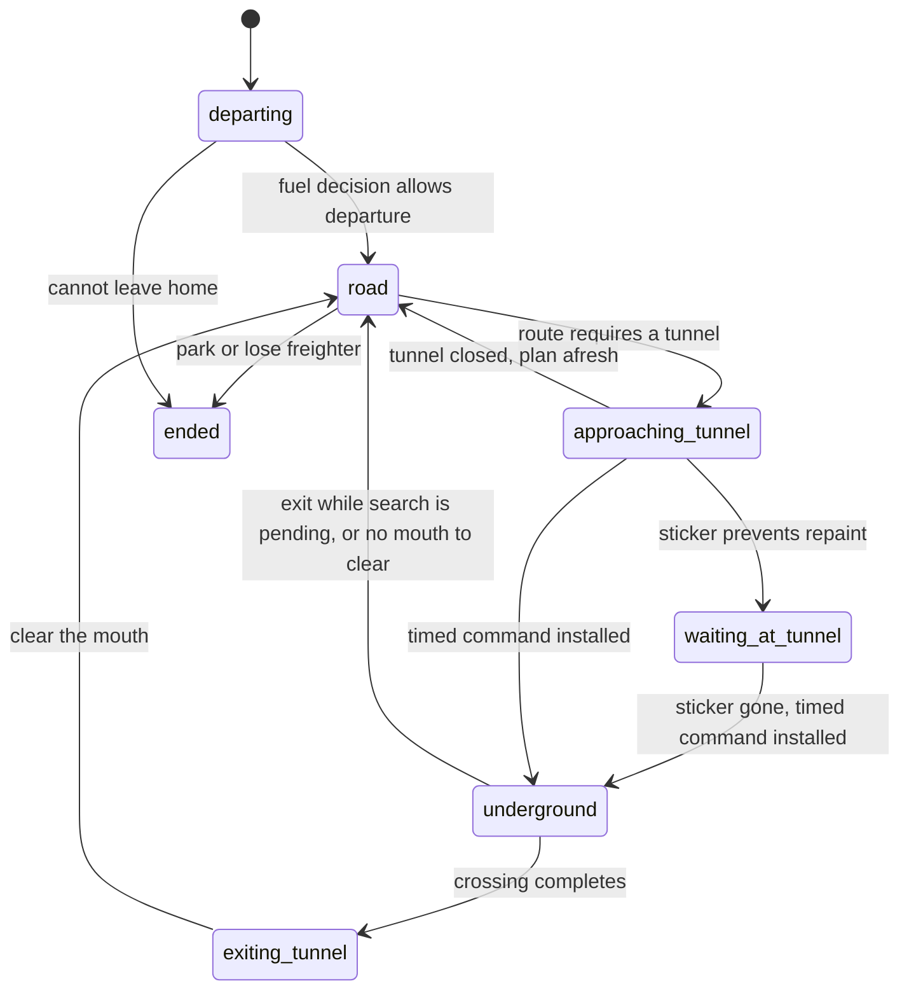

# Runtime state and transition ownership

The runtime uses independent domain states: a freighter can search for a new provider while
crossing a tunnel, which one combined `driving/loading/searching` enum would lose. Quantities (cargo, fuel, reservations) and engine objects remain data.

## Freighters

`scripts/trip-state.lua` owns saved lifecycle transitions. `scripts/logistics.lua` owns the
engine effects: commands, transfers, painting, registration and refunds. `scripts/fuel.lua`
and `scripts/routes.lua` use the same transitions when they start, finish or invalidate searches.

| Dimension | Representation | States and data |
| --- | --- | --- |
| Mission | `trip.state` | `to-provider`, `to-request`, `returning`; provider/request IDs and item remain on the trip |
| Search | `owner.search` (trip or depot) | absent = idle; `{kind = provider/fuel, phase = pending/retry, token, since}`; only pending owns a token; a trip's pending search may hold `again` (see `ask_again`). The search itself is a separate table, in `storage.searches` by path request or in `storage.road_answers` |
| Service | `trip.service` | absent = no service stop; `{kind = loading/unloading/refueling, since}`, only while `movement` is `road`; the engine's timed command controls completion |
| Movement | `trip.movement` | `departing`, `road`, `approaching-tunnel`, `waiting-at-tunnel`, `underground`, `exiting-tunnel`, `ended` |
| Tunnel | `trip.tunnel` | entry/exit, portal IDs, length and orientation, present only during approach/wait/crossing |
| Plan | `trip.plan`, `trip.planning` | `plan = {to, hops, step}`: the tunnels to its destination in turn (`tunnels.plan`), absent for no tunnels or unknown; `planning = {to, token, since}` while it waits for road lengths to be measured, cleared by `drive`, `begin_search` and `clear_route_search` |
| Road cut | `trip.road_cut` | `true` from road removed on its surface (`on_roads_changed`, which also clears `plan` and `origin`) until it plans again (`logistics.replan_cut`, after `cut_quiet` ticks without removals); a `planning` trip's `SEARCH_TIMEOUT` re-plan waits for it. On a surface with tunnels and with the removed tiles known, a trip with a plan or standing at a depot is left alone when the tiles cannot have been on its remaining roads (`tunnels.untouched`) |
| Fuel decision | `trip.fuel_check` | `unchecked` for a new leg; `checked` after refueling or deciding to continue without it; `trip.refuel` identifies the fuel stop |

Quality adds data, not states ([Quality](design/quality.md)): `trip.freighter_quality` and
`trip.mix` (nil for normal, as on older trips), `trip.graded` (set once a trip had a mix, so its
cargo is counted by quality all the way home; `logistics.set_parts` sets these with `planned`),
`depot.graded_fuel`, and a request's `quality` and `comparator` (nil for normal `=`).

`entering-tunnel` is a synchronous transition while replacing the visible unit and installing
its timed command. It is never left at an event boundary. Fuel amount, the crawl speed latch
`dry`, the one-reroute allowance `diverted`, and provider exclusion `passed` are orthogonal
constraints, not substitutes for movement or search state.

Removal can end a trip from any movement state. A removed destination can change the mission,
search and destination while underground; it cannot cancel the current crossing. A trip that
comes out while searching keeps its engine ID until the answer arrives, so the answer still
belongs to it.

| Event | Transition owner | Effects that must stay together |
| --- | --- | --- |
| Start or restart provider/fuel search | `begin_search`, `retry_search`, `cancel_search` | Kind, token and timeout origin change together; service ends; movement is independent |
| A busy pathfinder, for a freighter's search | `ask_again` | The search keeps its token, timeout origin and answered candidates; `again` holds it until the next check asks again |
| Change mission | `mission` | Clear service and update the promise ledger after the cargo/planned amount changes |
| Arrive at a depot | `begin_service` | Record the service kind, then install the existing one-second stop command |
| Begin a leg / finish fuel decision | `begin_leg`, `fuel_checked` | Reset or settle the decision; finishing releases search ownership and the fuel stop |
| Plan, enter or exit a tunnel | `road`, `move` | Movement phase and tunnel payload change together |
| Repaint | `rebind` | Move the storage index, home-depot index, engine ID and entity reference; keep `trip.key` |
| Finish | `finish`, then `end_trip` effects | Detach from the live-trip registry and ledger before destroying objects; return or lose the truck exactly once |
| Command failure | `logistics.failed_commands` | Check the live trip and command generation before acting, including underground failures |

`owns_search` accepts only the current pending token, so an old answer cannot dispatch, change
cooldowns or replace a newer route. All commands pass through `logistics.command`, which
increments `trip.command_id`; while `underground` it gives none, and `out_of_tunnel` drives on to
the current destination. Deferred failures use the generation they captured, so a failure from an
earlier approach cannot complete a newer crossing.

Cargo paint and depot status remain projections. Repainting changes the engine unit ID but not
the logical trip key used by reservations. Status text never drives a mission transition.

## Other lifecycle owners

| Concern | Owner and states | Reconciliation |
| --- | --- | --- |
| Fleet replenishment | `freighter-requests.lua`: absent = idle; `replenishment = {phase, target, quality, waiting}`, phases `reconciling`, `waiting-for-space`, `requested`. `depot.freighter_asks` keeps the stacks asked for in order, since the game reads plans back sorted by quality ([Quality](design/quality.md)) | `trim_freighter_requests` compares home/out/waiting trucks and real proxy plans with the target. Fulfillment or deliberate cancellation clears it. `waiting-for-space` may also have partial requests outstanding. Removal plans remain owned by Factorio. |
| Marked undo action | `undo.lua`: `locating`, `located`, `unlocated`; a located record has an action index | The removal mark identifies the action across moving history items. Failed mining retains the mark; cancellation/destruction forgets it. |
| Undo snapshot | `undo.lua`: `captured`, `pending`, `tagged`, `consumed`, `expired` | A successful matching removal moves the captured snapshot to pending. Tagging or an early undo consumes it; timeout discards it. Engine undo tags retain the settings after the transient record leaves storage. |
| Depot road ownership | `depot-road.lua`: absent = untracked, `owned`, `released` | All owners of a tile release together. Mining restores recorded layers once; covering preserves the player's tile. Shared ownership is derived from matching owned records, so it cannot become a stale flag. |
| Quality upgrade | `depot-upgrades.lua`: `storage.depot_upgrades` and `storage.depot_builds`, both for one tick | A depot mined to be replaced at another quality is noted, not refunded; the new one built at its spot that tick takes over its records (`*.replaced`) and trips' promises. Unmatched, `on_object_destroyed` cleans up. |

These keep their own representations, with no second framework or duplicate saved state.

| Concern | Owner | Contract |
| --- | --- | --- |
| Reservations, incoming cargo and spoilage | `promises.lua` | File on trip changes, by key; release before rerouting; refresh spoiled cargo at its recorded deadline; rebuild on configuration change |
| Path answers and road-length cache | `routes.lua` | Pending/cached answers carry ownership tokens; cache writes require the same road version; cached positives and negatives expire; a busy answer ends a depot's search and leaves a freighter's to ask again |
| Search candidates | `logistics.lua` (`search.candidates`, `search.rest`) | `candidates` holds those asked about so far; `rest` the others as a heap by rank, straight-line distance, then unit number ([Spreading the work](design/spreading-the-work.md)); a search without `rest` (an older save, a fuel search) holds them all in `candidates` |
| Tunnel topology and flood cache | `tunnels.lua` | Tile changes update the known floods; a removal that may split a network forgets it; without the event's tiles, added road marks topology stale and removal invalidates it ([Road tunnels](design/road-tunnels.md)); route construction owns rebuilding; the trip owns an in-progress crossing |
| Measured tunnel-route roads | `tunnels.lua` (`storage.tunnel_legs`, asks, waiters) | Road removed forgets at once the lengths its tiles can have been on and drops earlier answers with their questions and waiters; road laid marks lengths for measuring again at most once a second, keeping answers meanwhile; all expire after five minutes; unanswered questions are asked again after 10 s; only a leg's current question resumes its waiters, which drop themselves when stale; configuration changes clear them ([Road tunnels](design/road-tunnels.md)) |
| Depot admission and cooldowns | `logistics.lua` dispatch | Current demand, room, circuit gate, fleet, road, fuel and retry deadline determine eligibility and displayed status |
| Circuit snapshots and monitor output | `circuit-switch.lua`, `road-monitor.lua` | Snapshot/previous output belongs to its tick; subtract the depot's own contribution; dirty topology rebuilds before publishing |
| Robot access | `robot-access.lua` | Explicit user setting, subject to the engine's circuit override; separate from delivery admission |
| Blueprint parameter handoff | `depot-settings.lua`, `blueprints.lua` | Apply tags/helper settings once in either build order, then consume the helper; source identity and tick protect the handoff |
| GUI and inventory handoff | `request-gui.lua` | Player GUI ownership, controller/cursor state, carried count and chest baseline determine the action; synchronous inventory reentrancy is guarded and cleared on error |
| Impact sampling | `impact.lua` | Paused/fresh/active sampling and per-target cooldown; underground trips are excluded and exit resets the position sample |
| Research and legacy entities | `research.lua`, `legacy-depots.lua` | Engine owns research levels; event invalidation refreshes caches; configuration migration preserves or refunds existing entities |
| Cargo and paint | `cargo.lua`, `freighter-paint.lua` | Transfers preserve real stacks/fluid temperature; paint is derived from cargo and movement, not a second mission |
| Scheduling | `logistics.lua`, `control.lua` | Stable trip phases and a per-second depot plan spread work ([Spreading the work](design/spreading-the-work.md)); deferred failures retain command generation; removed trip identities are skipped |

## Save compatibility

Configuration setup migrates trips before depot cleanup can inspect them, restarting outstanding
searches but keeping the engine's current service/tunnel command. Migration
removes `searching`, `search_token`, `fuel_search`, `loading`, `departing`, `coming_out`,
`refueled`, `tunnel.under` and `tunnel.started`. The trip version prevents repeated conversion.
Legacy `freighter_target` becomes a replenishment record; old road `false` tombstones become
released records; undo queue membership and action indexes identify their old phases. A quality a
mod change removed is forgotten (`logistics.forget_lost_qualities`): requests for it become
normal, trips plan none of it, a freighter of it counts as normal and drives at normal speed
(dry ones still crawl), its parked fuel and robot quality go.
All migrations are idempotent and retain quantities, inventory objects, tags and ground layers.
The normal release configuration change runs them; no migration is performed in `on_load`.

## Regression protection

The shared `check` of `tests/lua/harness.lua` (run by `tests/lua/logistics.lua`, `quality.lua`
and `depot-swap.lua`) checks these invariants at each checkpoint: live trips have unique logical
identities, consistent entity/home indexes, valid search ownership, no search/service overlap,
service only on road, matching tunnel payloads and no retired flags. The Lua harness simulates
Factorio and does not prove engine behavior; `tools/test_mod.py` runs the package in Factorio
([Testing](testing.md)).
