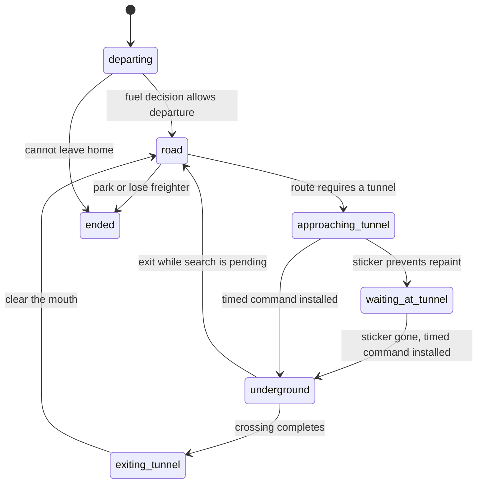

# Runtime state and transition ownership

The runtime uses independent domain states. A freighter can search for a new provider while
finishing a tunnel crossing; a single combined `driving/loading/searching` enum would lose that
valid combination. Quantities (cargo, fuel, reservations) and engine objects remain data.

## Freighters

`scripts/trip-state.lua` owns saved lifecycle transitions. `scripts/logistics.lua` owns the
engine effects: commands, transfers, painting, registration and refunds. `scripts/fuel.lua`
and `scripts/routes.lua` use the same transitions when they start, finish or invalidate searches.

| Dimension | Representation | States and data |
| --- | --- | --- |
| Mission | `trip.state` | `to-provider`, `to-request`, `returning`; provider/request IDs and item remain on the trip |
| Search | `owner.search` (trip or depot) | absent = idle; `{kind = provider/fuel, phase = pending/retry, token, since}`; only pending owns a token |
| Service | `trip.service` | absent = no service stop; `{kind = loading/unloading/refueling, since}`; the engine's timed command controls completion |
| Movement | `trip.movement` | `departing`, `road`, `approaching-tunnel`, `waiting-at-tunnel`, `underground`, `exiting-tunnel`, `ended` |
| Tunnel | `trip.tunnel` | entry/exit, portal IDs, length and orientation, present only during approach/wait/crossing |
| Plan | `trip.plan`, `trip.planning` | `plan = {to, hops, step}`: the tunnels to its destination in turn (scripts/tunnels.lua, `plan`), absent for no tunnels or unknown; `planning = {to, token, since}` while it stands waiting for road lengths to be measured, cleared by `drive`, `begin_search` and `clear_route_search` |
| Fuel decision | `trip.fuel_check` | `unchecked` for a new leg; `checked` after refueling or deciding to continue without it; `trip.refuel` identifies the fuel stop |

`entering-tunnel` is a synchronous transition while replacing the visible unit and installing
its timed command. It is never left at an event boundary. Fuel amount, the crawl speed latch
`dry`, the one-reroute allowance `diverted`, and provider exclusion `passed` are orthogonal
constraints, not substitutes for movement or search state.

Removal can end a trip from any movement state. A removed destination can change the mission,
search and destination while underground; it cannot cancel the current crossing. A trip that
comes out while searching keeps its engine ID until the answer arrives, so the answer still
belongs to it.

| Event | Transition owner | Effects that must stay together |
| --- | --- | --- |
| Start or restart provider/fuel search | `begin_search`, `retry_search`, `cancel_search` | Kind, token and timeout origin change together; service ends; movement is independent |
| Change mission | `mission` | Clear service and update the promise ledger after the cargo/planned amount changes |
| Arrive at a depot | `begin_service` | Record the service kind, then install the existing one-second stop command |
| Begin a leg / finish fuel decision | `begin_leg`, `fuel_checked` | Reset or settle the decision; finishing releases search ownership and the fuel stop |
| Plan, enter or exit a tunnel | `road`, `move` | Movement phase and tunnel payload change together |
| Repaint | `rebind` | Move the storage index, home-depot index, engine ID and entity reference; keep `trip.key` |
| Finish | `finish`, then `end_trip` effects | Detach from the live-trip registry and ledger before destroying objects; return or lose the truck exactly once |
| Command failure | `logistics.failed_commands` | Check the live trip and command generation before acting, including underground failures |

Path requests retain the token issued to them. `owns_search` accepts only the current pending
token; an old answer cannot dispatch, change cooldowns or replace a newer route. All commands
pass through `logistics.command`, which increments the generation. Deferred failures use the
generation they captured, so a failure from an earlier approach cannot complete a newer crossing.

Cargo paint and depot status remain projections. Repainting changes the engine unit ID but not
the logical trip key used by reservations. Status text never drives a mission transition.

## Other lifecycle owners

| Concern | Owner and states | Reconciliation |
| --- | --- | --- |
| Fleet replenishment | `freighter-requests.lua`: absent = idle; `replenishment = {phase, target}`, phases `reconciling`, `waiting-for-space`, `requested` | `trim_freighter_requests` compares home/out/waiting trucks and real proxy plans with the target. Fulfillment or deliberate cancellation clears it. `waiting-for-space` may also have partial requests outstanding. Removal plans remain owned by Factorio. |
| Marked undo action | `undo.lua`: `locating`, `located`, `unlocated`; a located record has an action index | The removal mark identifies the action across moving history items. Failed mining retains the mark; cancellation/destruction forgets it. |
| Undo snapshot | `undo.lua`: `captured`, `pending`, `tagged`, `consumed`, `expired` | A successful matching removal moves the captured snapshot to pending. Tagging or an early undo consumes it; timeout discards it. Engine undo tags retain the settings after the transient record leaves storage. |
| Depot road ownership | `depot-road.lua`: absent = untracked, `owned`, `released` | All owners of a tile release together. Mining restores recorded layers once; covering preserves the player's tile. Shared ownership is derived from matching owned records, so it cannot become a stale flag. |

The following machines already have domain owners and retain their existing representations.
Their lifecycle contracts explain when they are updated or invalidated; they do not need a
second framework or duplicate saved state.

| Concern | Owner | Contract |
| --- | --- | --- |
| Reservations, incoming cargo and spoilage | `promises.lua` | File on trip changes; release before rerouting; refresh spoiled cargo at its recorded deadline; rebuild on configuration change |
| Path answers and road-length cache | `routes.lua` | Pending/cached answers carry ownership tokens; cache writes require the same road version; cached positives and negatives expire |
| Tunnel topology and flood cache | `tunnels.lua` | Added road marks topology stale, removal invalidates it; route construction owns rebuilding; the trip owns an in-progress crossing |
| Measured tunnel-route roads | `tunnels.lua` (`storage.tunnel_legs`, `tunnel_leg_asks`, `tunnel_waiters`) | Road removed forgets lengths at once and drops answers asked before; road laid forgets them at most once a second and keeps answers; other tiles change nothing; all expire after five minutes; unanswered questions are asked again after 10 s; waiters (searches, by their wait; planning trips, by their token) are resumed on each answer and drop themselves when stale; configuration changes clear all three |
| Depot admission and cooldowns | `logistics.lua` dispatch | Current demand, room, circuit gate, fleet, road, fuel and retry deadline determine eligibility and displayed status |
| Circuit snapshots and monitor output | `circuit-switch.lua`, `road-monitor.lua` | Snapshot/previous output belongs to its tick; subtract the depot's own contribution; dirty topology rebuilds before publishing |
| Robot access | `robot-access.lua` | Explicit user setting, subject to the engine's circuit override; separate from delivery admission |
| Blueprint parameter handoff | `depot-settings.lua`, `blueprints.lua` | Apply tags/helper settings once in either build order, then consume the helper; source identity and tick protect the handoff |
| GUI and inventory handoff | `request-gui.lua` | Player GUI ownership, controller/cursor state, carried count and chest baseline determine the action; synchronous inventory reentrancy is guarded and cleared on error |
| Impact sampling | `impact.lua` | Paused/fresh/active sampling and per-target cooldown; underground trips are excluded and exit resets the position sample |
| Research and legacy entities | `research.lua`, `legacy-depots.lua` | Engine owns research levels; event invalidation refreshes caches; configuration migration preserves or refunds existing entities |
| Cargo and paint | `cargo.lua`, `freighter-paint.lua` | Transfers preserve real stacks/fluid temperature; paint is derived from cargo and movement, not a second mission |
| Scheduling | `logistics.lua`, `control.lua` | Stable trip phases spread work; deferred failures retain command generation; removed trip identities are skipped |

## Save compatibility

Configuration setup migrates trips before any depot cleanup can inspect them. It restarts
outstanding searches while preserving the engine's current service/tunnel command. Migration
removes `searching`, `search_token`, `fuel_search`, `loading`, `departing`, `coming_out`,
`refueled`, `tunnel.under` and `tunnel.started`. The trip version prevents repeated conversion.
Legacy `freighter_target` becomes a replenishment record; old road `false` tombstones become
released records; undo queue membership and action indexes identify their old phases.
All migrations are idempotent and retain quantities, inventory objects, tags and ground layers.
The normal release configuration change runs them; no migration is performed in `on_load`.

## Regression protection

`tests/lua/logistics.lua` checks lifecycle invariants at each behavioral checkpoint alongside
its reservation/incoming-cargo accounting checks. Live trips have unique logical identities,
consistent entity/home indexes, valid search ownership, no search/service overlap, matching
tunnel payloads and no retired flags. Event-sequence tests cover migration while loading and
while searching underground, stale answers after exit, stale failures before a new crossing,
repainting and duplicate completion/destruction events. Fleet, undo and road tests cover old
saved representations as well as their existing cancellation/removal races.

The Lua harness controls callback order and simulates Factorio objects; it does not prove
engine behavior alone. `tools/test_mod.py` checks the installed package in Factorio with and
without Space Age, including deliveries, fuel, tunnels, robots and undo. `benchmark_ups.py`
compares unchanged gameplay and tick cost against the base on the same machine.
