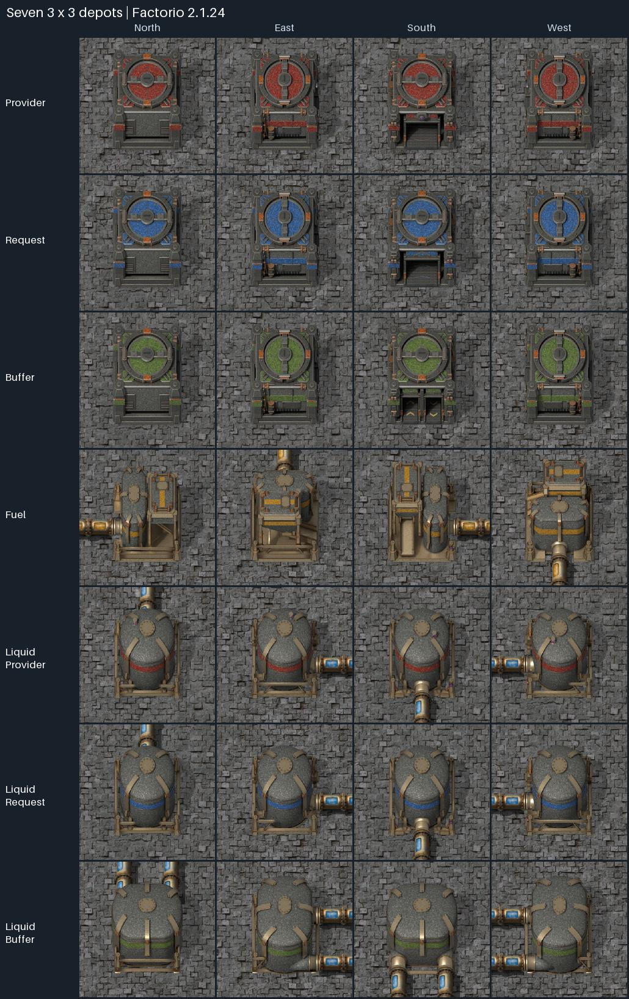
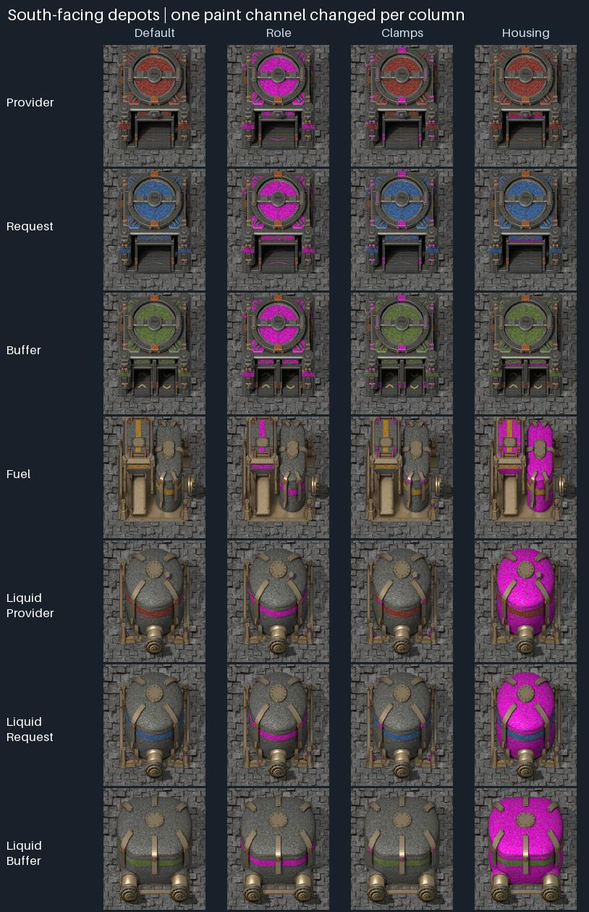
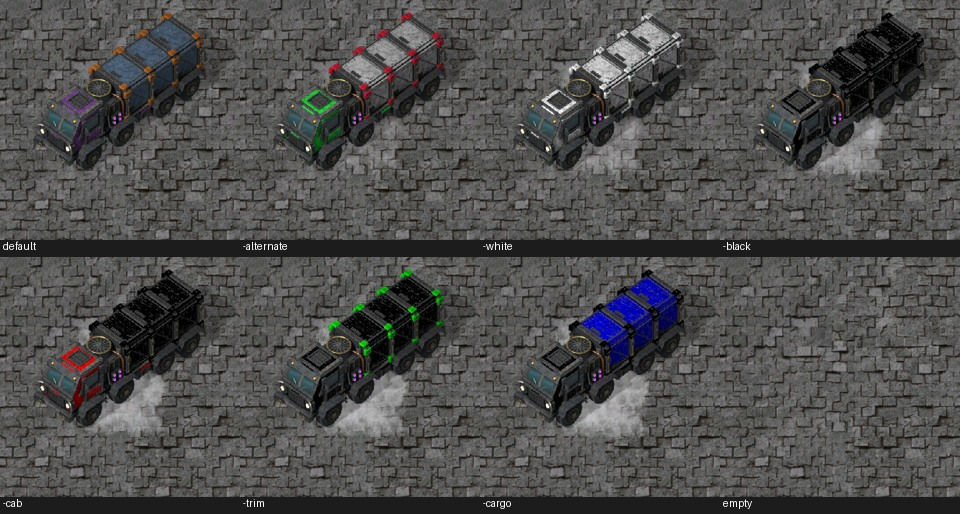
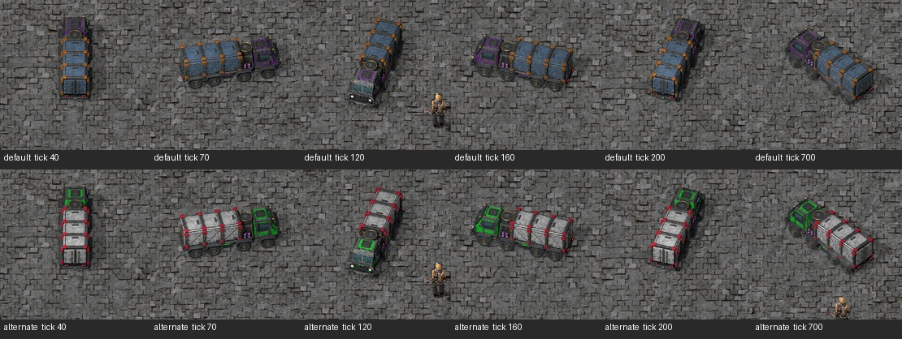

# Test results

Latest in-game results for the current artwork. The full screenshots and reports from every test round are kept in the private `jatz-distribution-archive` repository.

## Explicit runtime states: passed (automated)

**November 9, 2026.** Refactor against `af0429cd7673a3674e3b8a50d301616fd572a3de`,
Factorio 2.1.24 headless on Linux. Saved freighter flags become independent named movement,
search, service and fuel states; fleet, undo and road ownership have compatible migrations.
See [Runtime state and transition ownership](runtime-state.md).

- `tools/test_mod_setup.py`: all 14 setup tests passed, including the Lua logistics,
  control-event and depot-road harnesses and the runtime compiler/local-limit checks.
- Lifecycle invariants run at each logistics checkpoint. New sequences exercise saved loading
  and underground-search states, repeated migration, stale answers after exit, repaint identity,
  once-only refunds, old fleet targets, undo records and road ownership.
- A delayed approach failure ending a newer tunnel crossing reproduced on the base and passed
  after adding the command-generation guard to the underground failure branch.
- `tools/test_mod.py`: packaged mod passed with the base game and Space Age, including the
  automated undo scenario. These engine runs use fresh scenarios; migration callback ordering
  is covered by the Lua harness, not by a captured player save.
- StyLua 2.5.2, Luacheck 1.2.0 and Ruff 0.17.3 passed; release/package and emulator tests passed.
- A focused independent static review found no actionable regression in transitions or migrations.

The deterministic standard emulator comparison reports +3.3% mean Lua instructions (+2.1% p99,
+3.0% worst tick), with identical API calls, paths, commands, vehicles and deliveries. The
in-game standard comparison below has three alternating runs per revision. Run-to-run variation
is larger than the median change, so it establishes no speed improvement.

| | Mean update (ms) | UPS | Script (ms) | Pathfinder (ms) | p99 (ms) | Max (ms) | Run spread (ms) | Vehicles out | Delivered/min |
| --- | --- | --- | --- | --- | --- | --- | --- | --- | --- |
| Before | 1.276 | 784 | 0.499 | 0.056 | 4.146 | 11.678 | 0.272 | 1510 | 264720 |
| After | 1.214 | 824 | 0.488 | 0.053 | 3.517 | 9.975 | 0.132 | 1510 | 264720 |

## Mod: passed (automated)

**November 3, 2026.** `tools/test_mod.py` with Factorio 2.1.24 (build 87808) headless on Linux, loading the packaged `jatz-distribution_0.1.0.zip`. It ran once with the base game only and once with Space Age, and both passed:

| Check | Result |
| --- | --- |
| All 9 recipes (seven depots, the freighter, road) available from the start and free | Passed |
| Each of the 7 depots placed in all 4 directions, as a ghost and for real (28 each) | Passed |
| Full rotation of every placed depot (112 steps) | Passed |
| All 20 pipe ports connect; containers hold items, tanks hold fluid | Passed |
| A character enters the fuelled freighter and drives it (28.5 tiles in 2 seconds) | Passed |
| Freighter at 75% size in the graphical client | Seen in play by the owner up to November 3, 2026, who then asked for 60% |
| Freighter at 60% size (sprites and boxes; box 0.9 × 2.7 tiles, stored by the engine as 0.898 × 2.695, checked headless) in the graphical client | Untested |
| New 64 px icons in the graphical client: depots face south and the freighter heads south-east | **Passed:** checked by the owner on November 3, 2026, in the inventory and Factoriopedia |
| Loading zone marking in the graphical client: one tile beyond the footprint on the loading side, south when placed unrotated, worn rather than bright white | **Passed:** checked by the owner on November 3, 2026 (Provider depots on desert) |
| Marking drawn above decoratives (plants, ground cover): moved from `decals` to `ground-patch-higher2` after the owner saw plants drawn over it | Untested since the change |
| Decorative rocks drawn over the marking (`floor`/`object` layers): building or turning a depot now clears decoratives overlapping its loading zone tile. Covered by the automated check (28 zones cleared, decoratives beyond kept) | Untested in the graphical client |
| Menu placement in the graphical client: our row directly above the car and tank row, ordered provider, request, buffer, liquid provider, liquid request, liquid buffer, fuel, freighter | **Passed:** checked by the owner on November 3, 2026, alongside the Yuoki mods |
| Delivery over road: a provider with 50 iron plates and a request for 30, 20 tiles apart, joined by a U-shaped road with concrete on the straight line. A freighter drove out and back along the road (10-tile detour) and the request depot received exactly 30; the provider kept 20 | Passed |
| Freighters stay on road: every 10 ticks, all four corners of every delivering freighter stood on road (45 samples) | Passed |
| A request depot whose loading zone is an isolated road tile receives nothing and reports no route; one without road at its loading zone sends no freighter and says so | Passed |
| Cargo keeps item data: modular armor arrives with its solar panel; with Space Age, food that left 50% spoiled arrives at least as spoiled | Passed |
| A request depot with no room fetches nothing (provider keeps all 50 copper, status "full") | Passed |
| A freighter destroyed on its way is replaced, and the request is filled (30 steel) | Passed |
| Enemies (November 4, 2026, Factorio 2.1.24 headless, base game and Space Age): a medium biter held still on the road is killed by the freighter's impact damage, the 10 iron ore is still delivered, and a player beside the road is unhurt. Behemoth biters kill another freighter (physical damage), which explodes and leaves the car's wreck (`car-explosion`, `car-remnants`; neither appeared before this change); its depot is left with 2, asks robots for 1 at once, gets 10 copper ore from its other freighters, and robots bring the replacement (3 again). The destroyed-freighter depot above is restocked to 3 by robots too. Freighters show up in the pollution statistics. With the code before this change, a freighter killed by biters went back into the slot and nothing was requested | Passed headless; graphical retest pending |
| A freighter killed by enemies fails its command at 0 health before it is gone: it is lost, not taken home, and its provider isn't put on cooldown (Lua checks against a fake runtime) | Passed headless |
| A freighter killed by a script (`LuaEntity::die`, as from the console) fails its command with its health still showing (500): it is lost, not put back into its depot's slot, and the depot asks robots for a replacement (Lua checks; and November 6, 2026, Factorio 2.1.24 headless: a probe killing a freighter just after it left home and while it loaded at the provider, storage empty: slot 1, out 0, 1 requested; before the fix, slot 2 and nothing requested, the owner's "instant restock"; `tools/test_mod.py`'s destroyed pair now uses `die()` and requires the request, base game and Space Age) | Passed headless |
| A failed command is acted on the tick after only while it is still the freighter's latest: a loaded freighter whose way home fails, its request depot then removed in the same tick, takes its cargo back to the provider; one re-planned meanwhile keeps its route and puts no provider on cooldown (Lua checks; and November 7, 2026, Factorio 2.1.24 headless, a temporary probe mod destroying the request depot from inside the freighter's failure event, after this mod's handler: 100 iron plates back in the provider, none spilled; with the deferral alone, all 100 spilled, as Pullfrog's review of 66d57e9 found) | Passed headless |
| Construction robots repair a damaged freighter: one at 100 of 500 health within a roboport's reach, with repair packs in storage, is repaired to full (`tools/test_mod.py`, base game and Space Age, November 6, 2026); a probe saw a robot follow a delivering freighter and repair it while it stood at the provider (200 to 232, carried over to its repainted unit); on the road the freighter outruns the robot. Before, the freighter was `not-repairable` and no robot came | Passed headless |
| A freighter lost while its depot's chest has no free stack: the depot keeps its target and robots are asked for the replacement once a stack is free (Lua checks; and November 5, 2026, Factorio 2.1.24 headless, base game and Space Age, a temporary probe filling the chest at the loss: target 3 kept, request made once cleared, depot back to 3; without the fix, target nil and no request) | Passed headless |
| Freighters asked for while the chest has no free stack add up: 5 then 1 more keep a target of 6, a match to 6 adds nothing, and once a stack is free all 6 are requested in one plan, the target staying 6 (Lua checks; and November 5, 2026, Factorio 2.1.24 headless, a temporary probe: coming 6, target 6; without the fix, coming 1, target 1) | Passed headless |
| An enemy removed by another's death while a freighter runs them over is skipped, not read; nothing is hit once the freighter is gone (Lua checks; and November 5, 2026, Factorio 2.1.24 headless, a temporary probe whose death handler removes the neighboring biter: no error; without the fix, "LuaEntity API call when LuaEntity was invalid" in `on_nth_tick(10)`) | Passed headless |
| A request changed from plastic to circuits mid-trip loads no plastic | Passed |
| Freighters stop to load and unload: November 4, 2026 repair of PR #25, based on `52388cb`, with `LOADING_TICKS = 60`. Factorio 2.1.24 headless, Linux, base and Space Age: 63 ticks measured at both loading zones (bounds 50–70). The same unit stays valid through loading, driving home and unloading; all 3 freighters return to the slot. The one-second checks fail on the original 120-tick code (123 ticks measured). The owner reported the original pause was too long and the truck disappeared; premature loss did not reproduce headless. Removal after unloading returns the freighter item to its slot. | Passed headless; graphical retest pending |
| Cargo paint: November 4, 2026, Factorio 2.1.24 headless, Linux, base and Space Age. The connected pair's freighter reaches the provider as `jatz-freighter-drone` (empty, light grey), and loading iron plates replaces it, where it stood, with `jatz-freighter-drone-233` (iron ore's map color), which drives home, unloads and parks. Since this change the freighter is a new unit from loading onward, so the row above's "same unit" now holds up to loading and from loading to unloading. Water's paint is `jatz-freighter-drone-023`. 218 freighter prototypes load. Stickers: a freighter loading with a fire-like sticker (10-tick damage interval) stuck to it is not swapped, so the same sticker stays on the same freighter, and it takes iron plates' paint on the road home once the sticker wears off (90 ticks), delivering its 10 plates. Swapping lost stickers at first (Pullfrog's review of `a2c4274`), and recreating them restarted their damage cycle (its review of `14c2d32`); this check fails on both versions | Passed headless; colors untested in the graphical client |
| Cargo colors with overhaul mods (data stage only, scratch copies, not shipped): Bob's mods and Angel's refining, petrochem, smelting and bioprocessing from their `dev2.1` branches (November 4, 2026). Non-placeable items with a color: 476 of 514 with Bob's and Space Age, 842 of 923 with Bob's and Angel's (no Space Age); base game ores and plates keep their colors under Angel's. Krastorio 2 has no 2.1 version yet and its data stage fails on 2.1, so it is unmeasured | Measured headless |
| Delivering freighters slowed to Transport Drones' default speed: November 5, 2026, merged with `c7c1b65`, with `movement_speed = 0.066` (was 0.2; Transport Drones sets 0.066 before speed research, `script/transport_drone.lua` at `15c42d1`), about 4 tiles a second instead of 12. Factorio 2.1.24 headless, Linux, base and Space Age: deliveries finish at tick 1441, before the 1700-tick deadline. The check waits for the U-road depot's status, which updates at its next once-a-second dispatch, and the mended-road bound now scales with the drone's speed (535 ticks measured, bound 764; 520 at the old speed, as before) | Passed headless; graphical check of the slower driving pending |
| Road cut behind a loaded freighter: all 30 gears go back to the provider, none to the request, provider cooled down; the gears are back in the provider 63 ticks after the cut, the freighter's 1 s stop to unload included (2 ticks before freighters stopped; it used to take about 6 s of standing stuck) | Passed |
| Mending a gap in a road: delivery done 318 ticks (about 5 s, round trip and its two 1 s stops included; 195 ticks before the stops) after the repair, instead of waiting out the retry cooldown | Passed |
| Nearer of two providers removed mid-trip: the same freighter goes on to the other one and delivers | Passed |
| Request depot removed mid-trip: its freighter leaves at once and the provider keeps its stock | Passed |
| Provider nearest by road chosen: 8 tiles away in a straight line but 34 by road loses to 16 tiles on a straight road (all 10 coal from the farther one) | Passed |
| No road route to any provider or buffer depot: no freighter is sent at all | Passed |
| Depot road: laid under each depot's loading zone (over grass, which it hides); road ending one tile short of both depots' zones delivers (5 poles) | Passed |
| Depot road removed with its depot, putting back concrete and grass; existing road and a tile laid over depot road stay; a shared tile keeps its road until the second depot goes; nothing laid on water | Passed |
| Depot road when turning a depot, and mining or covering it by hand (Lua checks against a fake runtime; needs a player in game) | Passed headless; untested in the graphical client |
| Depot road art blending into player road, in the graphical client | Untested |
| Freighter slot: two freighters sent 60 ticks apart, one to each of two providers (30 + 30 sticks), all 5 back in the slot; no freighters, no trips (status "Waiting: no freighters"); freighters in the chest move to the slot; a destroyed request depot drops all 102 of its freighters (full slot of 100 plus 2 still in its chest) and a script-removed one its 3; the remote interface adds only up to the slot's limit of 100; 25 freighters are requested and taken away across several chest stacks | Passed |
| Mining a request depot hands all its freighters (slot and out) to the miner; the slot's one-stack limit counts freighters out; a freighter destroyed on the road is lost (Lua checks against a fake runtime) | Passed headless |
| Freighters requested as from remote view: 4 requested, a further request capped at the 5 that fit, cancelled (9) and 3 requested again; construction robots deliver them from storage into the slot (4 there, 2 left in storage) | Passed |
| Freighters taken away by robots (remote-view right-click): a removal marked and cancelled puts its freighter back; 2 marked are carried back to storage (slot 2, storage 4) | Passed |
| Slot clicks routed through control.lua: a freighter ghost requests (right-click: one), an empty cursor in remote view cancels, a remote right-click removes (again: cancels), remote view never moves items by hand; pipette over the slot picks up a freighter or its ghost, and only over the slot (Lua checks against a fake runtime) | Passed headless |
| Status light in the request panel (green, yellow, red, grey, with the status as tooltip), in the graphical client | Untested |
| Blueprint of a request depot keeps its request (tag) and freighters (insert plan for 3); the ghost built from it asks for 7 wood with 3 freighters requested; matching 1 to 3 requests 2; requests over the limit after filling by hand are trimmed (6 + 7 in → 3) | Passed |
| Copy and Paste settings, blueprint setup and building from a tagged ghost, routed through control.lua (Lua checks against a fake runtime) | Passed headless |
| Undo of a removed depot: its settings as it went (on robot pre-mining, or before mining by hand, chest freighters counted) go on the right removal action, newest to newest at one spot; undo puts them on the ghost (keeping its other tags), also when undone before the tag; the depot built from it has its request and asks for its freighters; a cancelled deconstruction forgets it, a mining attempt that leaves it standing doesn't (robots taking it later still save it as it goes, set back to defaults too), a failed hand mining leaves nothing waiting, three depots cut in one item are located with one read of it and their removals read none, a platform taking one before it is located and a stack trimmed under one still find their action, a depot mined by hand keeps its own action when a replacement at its spot is marked before the tagging (in the mining's tick or the tagging's), an undo bringing no ghost back leaves waiting settings alone, undoing anything else searches for no ghost, and with the history at its limit (100 items, the oldest dropped as one is pushed) two hand minings at one spot each keep their own, as does one with a replacement marked at its spot, and robots then find the replacement's action by its mark without reading an undo item, and two hand minings at one spot in adjacent ticks, the second before the tagging, each keep their own (Lua checks against a fake runtime). Real engine with a player (`--test-scenario jatz-distribution-check/undo`, Factorio 2.1.24): a cut depot changed to 8 wood and 5 freighters before robots took it is saved with 8 and 5 (the first version saved its 5 and 3 from marking), a depot mined by hand with 1 in its slot and 2 in its chest is saved with 3 (the first version: 1), their ghosts are rebuilt by robots and by the player with their request and freighters, and a cut depot the player then fails to mine (a full inventory) and changes to 9 wood is saved with 9 when robots take it (the second version saved 5); with Space Age, a liquid request depot cut on a space platform is saved with its water request and 2 freighters (the third version saved nothing) and rebuilt by the platform from its ghost with both; a depot mined by hand with 2 freighters and a bare replacement marked at its spot in the same tick keep 2 and 0 on their own actions (the fifth version lost the 2); with the history filled to 99 items, two depots mined by hand at one spot in a tick (2 freighters, then bare) keep 2 and 0 (the sixth version lost the 2); a depot mined by hand with 2 freighters and a bare one at its spot mined the next tick keep 2 and 0 (the seventh version swapped them) | Passed headless. The undo key press itself can't be scripted (test scenarios aren't simulations; no call applies an undo item): graphical client untested |
| Copy and Paste settings, copy and paste, and blueprints of request depots, in the graphical client | Untested |
| Ctrl+click of freighters into a request depot: 95 + 15 fills the slot to 100 and gives 10 back, none left in the chest; iron plates moved in with them stay in the chest; routed through control.lua for inventory changes and ctrl+click on the depot | Passed headless |
| A freighter request Factorio drops when part of it is filled by hand (5 asked, 1 put in) is requested again for the rest (4), also for a depot built over a blueprint ghost without its tags; taking freighters away stops topping up | Passed headless. In the owner's game (checked with `/jatz-freighters`): the request stays at 4 after 1 is put in by hand; the chest slot's ghost only came back slowly, because a freighter placed from the cursor waited for the next dispatch to move to the slot. Placing from the cursor now moves it at once |
| Ctrl+click of freighters, and of other items, into a request depot, in the graphical client | Untested |
| Buffer depots: a request depot set to request from buffers takes its 20 from a buffer 20 tiles away, not a provider 10 away; a buffer fills from the provider only (15); buffers have no request-from-buffers setting; the checkbox and Copy and Paste settings route through control.lua | Passed |
| Fallback to buffer depots with "Request from buffer depots" unticked (November 4, 2026, Factorio 2.1.24 headless, base game and Space Age): a liquid request depot takes its 300 crude oil from a liquid buffer 30 tiles away when the liquid provider 10 tiles away is empty (700 left in the buffer). Before the fix it got nothing and showed "no provider" | Passed |
| Fallback against a fake runtime: unticked, the provider still comes first with the buffer not asked; an empty provider, or one with no road route, leaves it to the buffer, for item and liquid request depots | Passed headless |
| Buffer depot panel and the "Request from buffer depots" checkbox, in the graphical client | **Passed:** checked by the owner on November 3, 2026 |
| Priority: a request depot takes its 10 stone from a provider 30 tiles away at priority 9, none from one 10 tiles away at priority 2; providers start at 5; request depots have none | Passed |
| Priority ordering against a fake runtime: a higher priority first however near a lower one is, the lower one when the higher has no road, nearest among equals, a priority 1 buffer before priority 10 providers, a changed priority restarting a waiting search; the slider panels, Copy and Paste settings, clones and blueprint tags, routed through control.lua | Passed headless |
| Priority slider on provider and buffer depot panels, in the graphical client | Buffer panel seen by the owner on November 3, 2026 (slider moved above the request at their request); provider panel untested |
| Liquid depots: 1200 water from a liquid provider holding 2000, in loads of 500 (800 left); 300 steam from a liquid buffer 30 tiles away at its 500 degrees, not from a liquid provider 10 tiles away; only liquid request and buffer depots get a truck chest; robots bring a liquid depot's 2 freighters through it into its slot; liquid depots refuse items and item depots fluids | Passed |
| Liquid depots against a fake runtime: kinds never mix (no item provider asked for a fluid, no liquid provider for an item, no paste across kinds); other fluid in the tank; fluid that no longer fits, or whose way back is lost, returns to the provider; mining hands over freighters and removes the truck chest; the liquid panels, fluid chooser and blueprint tags through control.lua | Passed headless |
| Liquid depot panels, fluid deliveries and robot-delivered freighters, in the graphical client | **Failed** for the owner on November 3, 2026: the liquid provider showed no panel, and opening a liquid request depot crashed (`Unknown filter type: is-parameter`). Fixed: panels anchor to `pipe_gui` (2.1 removed `storage_tank_gui`), and the fluid chooser uses fluid filters only. Retest pending |
| Compact freighter line: the slot shows freighters at home, the line beside it how many are out ("3 out", always) and a green "+N" while N are requested; full breakdown as tooltip, in the graphical client | Untested |
| Request ghosts in an open depot window after a freighter is put in by hand: Factorio doesn't redraw them for script changes; reopening the window by script fixed it but flashed the window, so (owner's choice) the ghost updates on the next open and the panel's "+N" shows the live count | Owner checked the flash version on November 3, 2026; panel version untested |
| Freighter slot in the request panel in the graphical client: ghost requests and robot removal in remote view, pipette (Q) over the slot | **Passed:** checked by the owner on November 3, 2026 |
| Fuel (November 4, 2026, Factorio 2.1.24 headless, Linux, base game and Space Age): a freighter with fuel for 10 tiles, sent to a provider 20 tiles east, stops first at a Fuel depot 4 tiles west, takes 5 of its 10 coal (20 MJ), then fetches its 10 iron ore and parks with 19 MJ; another fills up with 20 of 100 petroleum gas (made burnable by the check mod) and fetches 10 copper ore; one with an empty tank, whose Fuel depot holds only stone, stays home with status "no fuel" (nothing received at tick 300), then crawls to the depot once 5 coal are put in, fills up and fetches 10 sulfur. Every Fuel depot gets its hidden tank facing as it does, its pipe port connects in all 4 directions, and a Fuel depot turned by script turns its tank | Passed headless |
| No fuel to get (November 5, 2026, Factorio 2.1.24 headless, Linux, base game and Space Age): the empty-tank freighter above, whose road reaches only its stone-filled Fuel depot while Fuel depots with coal and petroleum gas stand on other roads, stays home with the yellow status `no-fuel` (not red), and its depot is delivering by tick 420, a second after coal arrives, instead of after its 10-second wait | Passed headless |
| No fuel to get against a fake runtime: no Fuel depot at all, or one with fuel but no road route, is red `no-fuel-depot` and searches nothing more until a Fuel depot is built (then it goes at once); an empty Fuel depot on its road is yellow `no-fuel`, never a place to wait, even with a stocked one on another road; fuel put in sends it at once | Passed headless |
| Fuel display and petroleum gas (November 5, 2026, Factorio 2.1.24 headless, Linux, base game and Space Age): the low freighter's hover status (`custom_status`, read back) is `jatz-gui.freighter-fuel` with a yellow dot when it reaches the Fuel depot; the liquid freighter fills up with 50 of 100 petroleum gas at the mod's own 0.4 MJ (the check mod no longer sets a value) | Passed headless |
| Fuel display and big fuel items against a fake runtime: hover status green, yellow when low, red when dry, refreshed after filling up and after repainting, none with fuel off; a 10 GJ item taken whole, shown in GJ, kept parked and sent first; the request panel's fuel line and tooltip | Passed headless |
| Freighter fuel on hover and the request panel's fuel line in the graphical client (whether the status line shows on a unit's hover) | Untested |
| Cloning a Fuel depot (November 5, 2026, Factorio 2.1.24 headless, Linux, base game and Space Age): with 10 coal and 1,234 water, cloned alone (`LuaEntity::clone`) and with its hidden tank (`LuaSurface::clone_entities`), each clone holds water 1234 and 10 coal with exactly one tank, and the original is unchanged. The previous code kept the coal but lost all the water in both cases | Passed headless |
| Cloning a Fuel depot against a fake runtime: alone it gets the original's fluid and temperature; with its tank, either event order, it adopts that tank and makes none; a second tank cloned onto it, or one cloned without its depot, is removed | Passed headless |
| Fuel against a fake runtime: burning by the tile, the nearest Fuel depot by road first, liquid fuel before items, a fuel cell leaving its used cell, overfill by one item, staying home or going without, cooldown after no route, running dry (crawling, then full speed after filling up), a removed Fuel depot, fuel turned off, the Fuel depot panel and flush button through control.lua | Passed headless |
| Fuel depot panel (liquid fuel and flush), freighters refuelling, and a dry freighter crawling, in the graphical client | Untested |
| Nothing left on the ground by any check | Passed |
| Unknown items and non-numeric counts are refused without changing the request; a cloned request depot keeps its request; clearing works | Passed |
| Road laid from a ghost on grass; refused on water | Passed |
| A save made by the PR's first version, with a freighter on its way, loads and finishes the delivery | Passed (one-off check) |
| Road tile art, transitions and the item icon in the graphical client | Untested |
| Alt-mode cargo icons (November 4, 2026; Factorio 2.1.24 headless, Linux, base and Space Age): the tracked freighter has no icon on reaching the provider empty and `utility/entity_info_dark_background` + `item/iron-plate` (alt mode only) on getting home loaded; a freighter carrying water showed `fluid/water`. Both checks fail with the icon call removed | Passed headless |
| Alt-mode cargo icon size and placement on the freighter in the graphical client (0.6 scale, centred on the truck) | Untested |
| Request panel beside the request depot's window (item, amount, status), and Copy and Paste settings between request depots | **Passed:** the owner reported the first version working in game on November 3, 2026; the panel is unchanged since |
| Mining Drones depots as item providers (November 5, 2026, on `3267fc0`; Factorio 2.1.24 headless, Linux, base and Space Age; `tools/test_mod.py --mod` with each of Mining_Drones 2.1.1, Mining_Drones_Remastered 2.3.0 and Mining_Drones_Mod 2.1.1, zips matching the mod portal's SHA-1): a north-facing mining depot set to mine iron ore, with 40 ore in its output, lays depot road behind its southern end, and a request depot 12 tiles along the road receives 30 of it (10 left); every other check passes unchanged with each mod and without any. Without the change the delivery never happens and the run fails at the deadline. The ore was put in the output by script, not mined by drones | Passed headless; mining depot priority panel and real drone-mined stock untested in the graphical client |
| Milestones preset addon (November 5, 2026, on `d0caa8f`; Factorio 2.1.24 headless, Linux, base and Space Age; `tools/test_mod.py --mod` with Milestones 1.5.2, zipped from its GitHub release commit `45532bd` since the portal zip needs a login): Milestones logs `Preset addons loaded: {"Jat'z Distribution"}` on the new game (`{}` without the change, which also lacks the interface the check calls), with no validation warnings, and the addon's three item milestones are all real items; every other check passes unchanged with Milestones and without it | Passed headless; milestones being reached and shown in the Milestones window untested in the graphical client (Milestones tracks only forces with players) |
| Corner turns with the delivering freighter's box narrowed from 0.8 to 0.4 tiles (November 6, 2026, on `226010f` plus this change; Factorio 2.1.24 headless, Linux): a probe mod logged one freighter's position and heading every tick, driving north and turning west on one-tile roads. At a crossroads the 0.8-tile box overshot 0.29 tiles north, stood pinned against the off-road corner for about 25 ticks while sliding sideways, then drove back about 12° off west; the 0.4-tile box never stops, swerves past the centre line (up to about 40°, 0.12 tiles) and settles within about 1.5 tiles. `rotation_speed` (0.05 to 0.5) and splitting the command at the corner left the path unchanged. `tools/test_mod.py`, base and Space Age: passed, every freighter on road | Passed headless |
| Corner turns with the 0.4-tile box in the graphical client | Untested. The owner chose the swerve as more natural from a replay of the measured paths, November 6, 2026 |
| Wrecks (November 8, 2026, Factorio 2.1.24 headless, Linux, base game and Space Age; `tools/test_mod.py`): each of the seven depots destroyed (`die`) facing east, south and west leaves one corpse, its own (`jatz-<role>-depot-remnants`), facing as the depot did (21 wrecks); biters destroy a delivering freighter, which explodes and leaves `jatz-freighter-remnants` facing the way it drove (orientation 0.75, corpse direction west). With `main`'s prototypes the same checks fail on `steel-chest-remnants` and `storage-tank-remnants` | Passed |
| Wrecks in the graphical client (look, size, shadow, paint, the half-turned depots' facing) | Untested: headless runs don't draw. The packaged frames are in `assets/depots/remnants/*/previews/directions.png` |

## Depots: passed

**November 7, 2026: depots lowered to 0.6 of their height above 0.75** (`assets/depots/tools/lower_depots.py`), with the item and Fuel depots' circuit connector 3 px lower. Factorio 2.1.24 headless on Linux: `tools/test_depot_art.py` passed (28 depots placed, 28 ghosts, 112 rotation steps, 20 pipe connections, reload), and `tools/test_mod.py` passed with the base game and with Space Age, its undo scenario included. The geometry and junction inspectors passed on the lowered masters.

| Check | Result |
| --- | --- |
| Lowered depots in the graphical client: all seven in four rotations, what stands behind them visible, pipes seated, shadows, cargo openings, ghosts | Untested |
| Item and Fuel depots' circuit connector on the pillar, below the painted band, with wires attached | Untested in the graphical client (placed from the sprite sheets) |

The screenshots below, in the README and on the Mod Portal page still show the depots at their old height.

**November 3, 2026.** Tested artwork commit `b3159d0`. Environment: Factorio 2.1.24 (build 87808) full client, Windows 11, Direct3D 11, AMD Radeon 780M.

| Check | Result |
| --- | --- |
| All seven designs in all four rotations | Passed |
| Pipes: all 20 vanilla pipe connections join the building; the 172 unused edge positions stay unconnected; covers and connector overlap match the vanilla assembler | Passed |
| Placement: 28 held placements, 112 rotation steps, 28 blueprint ghosts, adjacent fit, overlap rejection | Passed |
| Save and reload, with a second launch | Passed |
| Independent role, clamp and housing colors; grayscale masks | Passed |
| Shadows (including at night), cargo openings, freighter and player beside every loading face | Passed |
| Liquid Buffer bolted pipe adapters, at play zoom and in four housing colors | Passed |
| Fuel depot hopper interior (hidden behind a closed hatch) | Untested |
| Automated dispatch, cargo transfer and one-way fluid flow | Not implemented yet |

## Freighter: passed, with one known issue

**November 1, 2026.** Tested artwork commit `bc9dfc0`. Environment: Factorio 2.1.24 (build 87808) full client, Windows 11, Direct3D 11, AMD Radeon 780M.

| Check | Result |
| --- | --- |
| All 64 directions at two zoom levels match the exported frames, including the 63→0 wrap | Passed |
| In-game size (20% smaller than the first version) | Passed |
| Armored cab, fan, glass and wear details | Passed |
| Tint isolation (default, alternate, white, black and each layer alone) | Passed |
| Shadows at eight compass headings and at night | Passed |
| Driving forward, in full circles and in reverse | Passed |
| Selection and collision boxes | **Failed** in this artwork fixture, which inherits the base car's boxes (they cover only the middle of the truck). The mod's freighter now uses a 1.5 × 4.5 tile box measured from the sprites (scaled with the sprites to 60% in game); that still needs a graphical check (see Mod above). |
| Wheel animation | Not implemented yet (one static frame per direction) |

