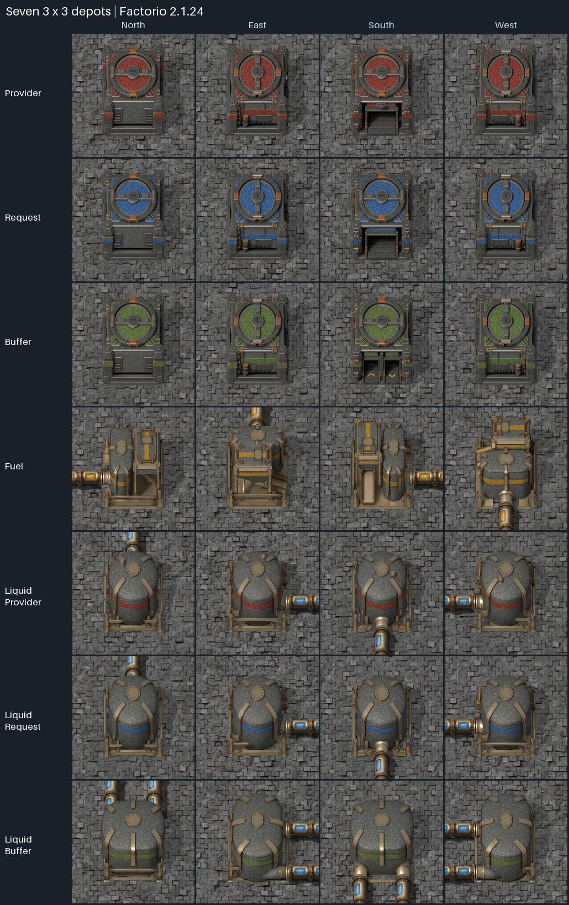
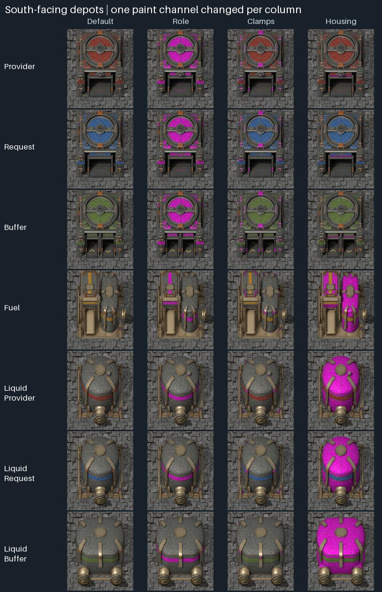
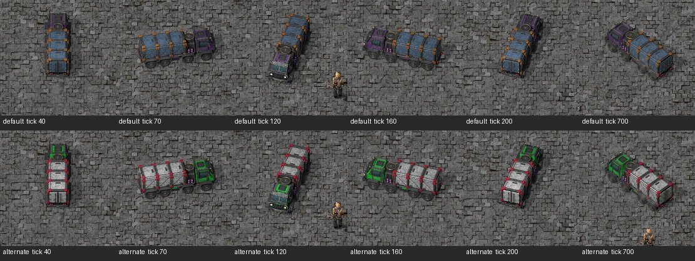

# Test results

The latest test result for each area of the mod. When you test an area again, replace its entry rather than adding another; superseded rounds stay in git history. Screenshots and reports from before November 3, 2026 are kept in the private `jatz-distribution-archive` repository.

## Freighter network window: automated checks passed (November 16, 2026)

PR #115, last checked on `e6e02e3` plus its review fix; Factorio 2.1.24 and 2.1.25 headless on Linux, Lua 5.2.4.

- Rows are single lines with named, right-aligned number columns; pages hold seven rows (a row is about 60 px at the default UI scale, so eight overflowed); a window saved by an earlier build is rebuilt from the cached snapshot on any write, an age-label update included.
- `tools/test_mod.py` passed with base and Space Age, including the `network` scenario. `tests/lua/control-events.lua` (via `tools/test_mod_setup.py`), lint, release, portal and package checks passed. `tools/emulate_ups.py` was identical to the base.
- **Still needed:** graphical confirmation of the alignment and spacing, that seven rows show with no scrollbar, and live multiplayer.

## Z-key freighter drops: passed (November 16, 2026)

Branch `fix/z-drop-freighter-absorption`, based on `51c25b6`; Factorio 2.1.25 (build 88022) headless on Linux, Lua 5.2.4.

- The Lua event regression (the single-item-drop registration) and the leftover-removal regression fail before the fix and pass with it. `tools/test_mod.py` passed with base and Space Age, including the `drop-freighters` scenario. Setup, emulator, release, portal, package and lint checks passed; engine benchmark and emulation unchanged.
- **Graphical check passed (owner-confirmed):** Z-dropping loads the depot and loaders do not immediately extract the dropped freighter.
- **Known gaps:** the exact event order was not instrumented, and modded inserter and loader variants were not recorded. The headless scenario supplies the event payload to the production handler because the engine cannot raise this event by script.

## Buffers pull by priority: passed (automated)

PR #112: the feature on November 15, 2026 (against `main` at `a826850`), its review repair on November 16 (`7bbe417`, against `51c25b6`); Factorio 2.1.24 headless on Linux, base game and Space Age.

- `tools/test_mod.py` passed: with the startup setting on, item and liquid buffers at priorities 2, 5 and 8 moved stock upward, and the liquid kept its 80 degrees. A buffer pull whose source was replaced by a request depot on the way now takes nothing there; the new check fails on the previous revision.
- `tools/test_mod_setup.py`, the emulator tests, lint, release, portal and package checks passed. The benchmark (default settings, existing map) was unchanged; it does not measure a large network of opt-in buffer chains.
- No graphics changed; no graphical-client check was done.

## Quality: passed (automated)

**November 14, 2026.** Rebased onto `016bc60`; Factorio 2.1.24 (build 87808) headless on Linux, base game and Space Age with Quality.

- `tools/test_mod.py` passed, including the `quality` and `bonuses` scenarios; against the base the quality scenario fails. `tools/test_mod_setup.py` passed, including `tests/lua/quality.lua`. Lint and emulator tests passed. Seven review rounds' defects are fixed, each with a check that fails before its fix.
- The owner found the panel's comparator between the item and its amount; a "Quality" row under them now holds it.
- Benchmark against `016bc60`: same vehicles and deliveries; the emulator reports +2.7% mean Lua instructions.
- **Not checked:** the request panel and freighter slot tooltip in the graphical client, and an open panel's save and load in the engine (checked with the real handlers only).

## Explicit runtime states: passed (automated)

**November 9, 2026.** Refactor against `af0429c`; Factorio 2.1.24 headless on Linux. See [Runtime state and transition ownership](runtime-state.md).

- `tools/test_mod_setup.py` passed, with lifecycle invariants at each logistics checkpoint. `tools/test_mod.py` passed with base and Space Age, including the `undo` scenario. Lint, release, package and emulator tests passed.
- **Known gap:** the engine runs use fresh scenarios; migration callback ordering is covered by the Lua harness, not by a captured player save.
- The emulator reports +3.3% mean Lua instructions with identical deliveries; the in-game comparison establishes no speed change.

## Mod: passed (automated)

**November 3–8, 2026.** `tools/test_mod.py` with Factorio 2.1.24 (build 87808) headless on Linux, loading the packaged `jatz-distribution_0.1.0.zip`, base game and Space Age: every check passed, as did the Lua harnesses against a fake runtime. Notes:

- The freighter's 0.9 × 2.7 box is stored by the engine as 0.898 × 2.695.
- A freighter killed by a script (`LuaEntity::die`) fails its command with its health still showing; it is counted as lost and replaced.
- Factorio drops a freighter request when part of it is filled by hand (5 asked, 1 put in); the rest is requested again. Seen in the owner's game too.
- The undo key press can't be scripted (test scenarios aren't simulations; no call applies an undo item).
- Mining Drones (November 5, on `3267fc0`): passed with Mining_Drones 2.1.1, Mining_Drones_Remastered 2.3.0 and Mining_Drones_Mod 2.1.1. The ore was put in the output by script, not mined by drones.
- Milestones 1.5.2 (November 5, on `d0caa8f`, zipped from its GitHub release commit `45532bd` since the portal zip needs a login): the preset addon loaded with no warnings.
- Cargo colors with overhaul mods (data stage only): measured with Bob's and Angel's `dev2.1` branches. Krastorio 2 has no 2.1 version and its data stage fails on 2.1, so it is unmeasured.
- Corner turns: the delivering freighter's box was narrowed from 0.8 to 0.4 tiles; `rotation_speed` and splitting the command at the corner left the path unchanged.
- A save made by the PR's first version, with a freighter on its way, loads and finishes the delivery (one-off check).

In the graphical client:

| Check | Result |
| --- | --- |
| Freighter at 60% size (sprites and boxes) | Untested. The owner saw 75% in play up to November 3, 2026, then asked for 60% |
| 64 px icons: depots face south, the freighter heads south-east | **Passed:** owner, November 3, 2026 (inventory and Factoriopedia) |
| Loading zone marking | **Passed:** owner, November 3, 2026. Moved from `decals` to `ground-patch-higher2` after the owner saw plants drawn over it: untested since. Decoratives cleared from the zone: untested |
| Menu placement, directly above the car and tank row | **Passed:** owner, November 3, 2026, alongside the Yuoki mods |
| Request panel, and Copy and Paste settings between request depots | **Passed:** owner, November 3, 2026 (first version; unchanged since) |
| Freighter slot in the request panel: remote-view requests and removal, pipette (Q) | **Passed:** owner, November 3, 2026 |
| Buffer depot panel and "Request from buffer depots" | **Passed:** owner, November 3, 2026 |
| Priority slider | Buffer panel seen by the owner, November 3, 2026 (slider moved above the request at their request); provider panel untested |
| Liquid depot panels, deliveries and robot-delivered freighters | **Failed** for the owner, November 3, 2026: no liquid provider panel, and a liquid request depot crashed (`Unknown filter type: is-parameter`). Fixed: panels anchor to `pipe_gui` (2.1 removed `storage_tank_gui`) and the fluid chooser uses fluid filters only. Retest pending |
| Request ghosts after a freighter is put in by hand | Factorio doesn't redraw them for script changes; reopening the window flashed it, so (owner's choice) the ghost updates on the next open and the panel's "+N" shows the live count. Owner checked the flash version; panel version untested |
| Freighters stopping to load and unload | Retest pending. The owner reported the original pause too long and the truck disappearing; the loss did not reproduce headless |
| Enemies, freighter wreck, slower driving | Retest pending |
| Corner turns with the 0.4-tile box | Untested. The owner chose the swerve as more natural from a replay of the measured paths, November 6, 2026 |
| Wrecks (look, size, shadow, paint, facing) | Untested; packaged frames in `assets/depots/remnants/*/previews/directions.png` |
| Cargo paint colors; alt-mode icon size and placement | Untested |
| Status light; compact freighter line; Copy and Paste settings and blueprints; ctrl+click into a request depot | Untested |
| Undo of removed depots | Untested (the key press can't be scripted) |
| Depot road when turning or mining by hand; its art blending into player road; road tile art, transitions and item icon | Untested |
| Fuel on hover (whether the status line shows on a unit's hover) and the panel's fuel line; Fuel depot panel, refuelling, a dry freighter crawling | Untested |
| Mining depot priority panel and real drone-mined stock | Untested |
| Milestones reached and shown | Untested (Milestones tracks only forces with players) |

## Depots: passed

**November 7, 2026: depots lowered to 0.6 of their height above 0.75** (`assets/depots/tools/lower_depots.py`), with the item and Fuel depots' circuit connector 3 px lower. Factorio 2.1.24 headless on Linux: `tools/test_depot_art.py` passed (28 depots placed, 28 ghosts, 112 rotation steps, 20 pipe connections, reload), and `tools/test_mod.py` passed with the base game and with Space Age, its undo scenario included. The geometry and junction inspectors passed on the lowered masters.

| Check | Result |
| --- | --- |
| Lowered depots in the graphical client: all seven in four rotations, what stands behind them visible, pipes seated, shadows, cargo openings, ghosts | Untested |
| Item and Fuel depots' circuit connector on the pillar, below the painted band, with wires attached | Untested in the graphical client (placed from the sprite sheets) |

The screenshots below, in the README and on the Mod Portal page still show the depots at their old height.

**November 3, 2026.** Tested artwork commit `b3159d0`. Environment: Factorio 2.1.24 (build 87808) full client, Windows 11, Direct3D 11, AMD Radeon 780M.

| Check | Result |
| --- | --- |
| All seven designs in all four rotations | Passed |
| Pipes: all 20 vanilla pipe connections join the building; the 172 unused edge positions stay unconnected; covers and connector overlap match the vanilla assembler | Passed |
| Placement: 28 held placements, 112 rotation steps, 28 blueprint ghosts, adjacent fit, overlap rejection | Passed |
| Save and reload, with a second launch | Passed |
| Independent role, clamp and housing colors; grayscale masks | Passed |
| Shadows (including at night), cargo openings, freighter and player beside every loading face | Passed |
| Liquid Buffer bolted pipe adapters, at play zoom and in four housing colors | Passed |
| Fuel depot hopper interior (hidden behind a closed hatch) | Untested |
| Automated dispatch, cargo transfer and one-way fluid flow | Not implemented yet |

## Freighter: passed, with one known issue

**November 1, 2026.** Tested artwork commit `bc9dfc0`. Environment: Factorio 2.1.24 (build 87808) full client, Windows 11, Direct3D 11, AMD Radeon 780M.

| Check | Result |
| --- | --- |
| All 64 directions at two zoom levels match the exported frames, including the 63→0 wrap | Passed |
| In-game size (20% smaller than the first version) | Passed |
| Armored cab, fan, glass and wear details | Passed |
| Tint isolation (default, alternate, white, black and each layer alone) | Passed |
| Shadows at eight compass headings and at night | Passed |
| Driving forward, in full circles and in reverse | Passed |
| Selection and collision boxes | **Failed** in this artwork fixture, which inherits the base car's boxes (they cover only the middle of the truck). The mod's freighter now uses a 1.5 × 4.5 tile box measured from the sprites (scaled with the sprites to 60% in game); that still needs a graphical check (see Mod above). |
| Wheel animation | Not implemented yet (one static frame per direction) |

