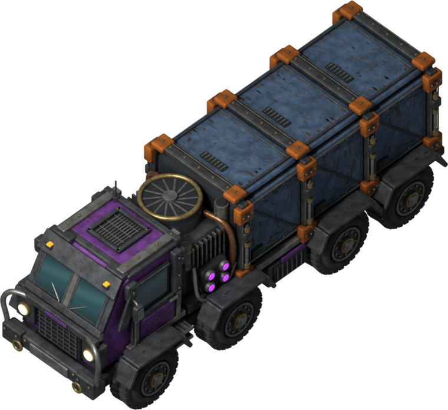
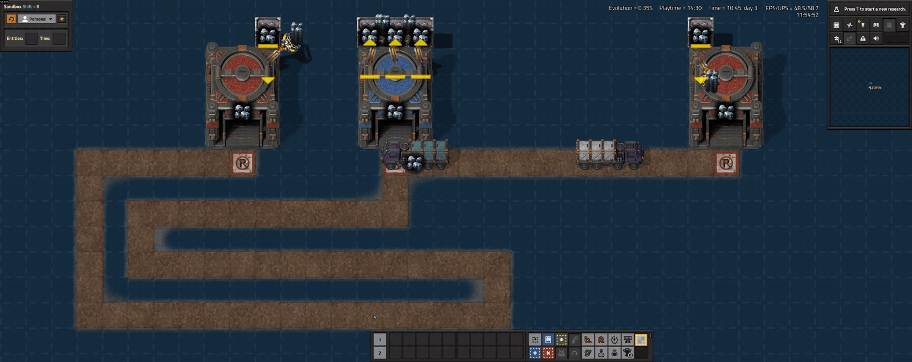
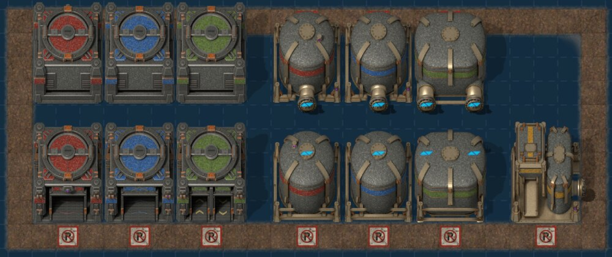
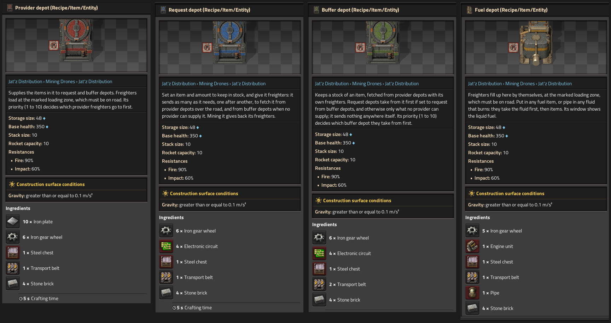
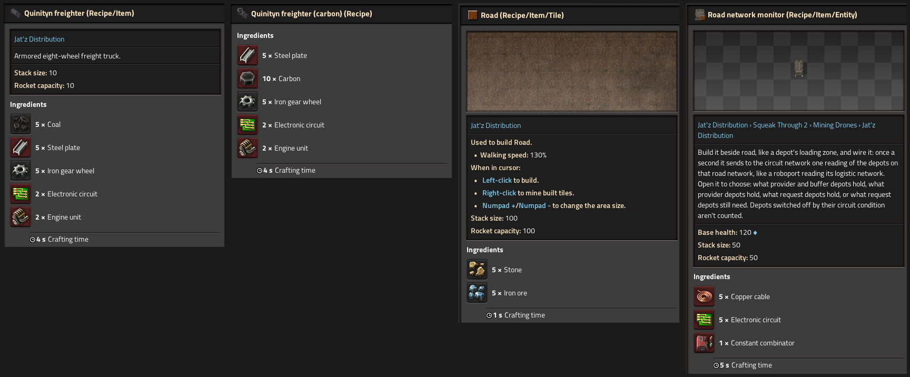
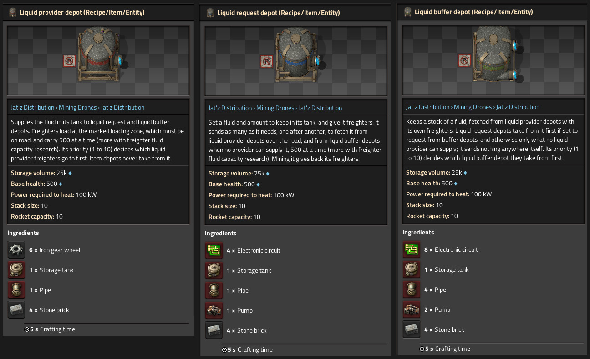
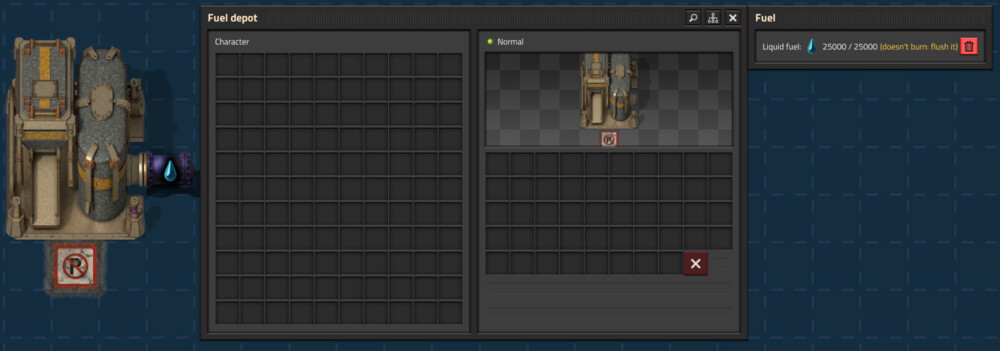

**Heavy freighters. Your roads. A factory that supplies itself.**

Build depots where goods are made and where they're needed, lay road between them, and armored **Quinityn freighters** do the hauling. Jat'z Distribution is a road logistics system for **Factorio 2.1**, inspired by Klonan's [Transport Drones](https://mods.factorio.com/mod/Transport_Drones) and rebuilt around big trucks, big loads and big factories.

- **Request** an item or fluid at a depot, and freighters fetch it from the provider that's nearest **by road**.
- **Haul** ten stacks of items or 500 fluid a trip from the start, and up to 15 stacks or 750 fluid with research.
- **Fuel** your fleet with any fuel item or burnable fluid. Freighters top up at fuel depots on their own.
- **Scale** to hundreds of depots and thousands of freighters, with the work spread evenly over every second.
- **Run over** the biters in your way. Freighters don't stop for anything.

*87 seconds in game, uncut: a request depot sends its freighters along the road to the provider depots, they load and bring the goods home, and the depots' panels show what's going on. Watch which provider they pick: distance is measured along the road, not in a straight line. The provider on the left looks closer, but its road winds a long way round, so the freighters head for the one the road reaches sooner. Click for full size. It's a large animation, so give it a moment to load.*

**[Player guide](../docs/guide.md)** · **[Report a bug](https://github.com/jatmn/jatz-distribution/issues)** · **[Source code](https://github.com/jatmn/jatz-distribution)**

---

## Coming from Transport Drones?

You'll feel at home: roads, provider and request depots, buffers, fluids and fuel all work the way you expect. Here is what's different.

**Not a drop-in replacement.** Jat'z Distribution is its own mod, not an update or fork of Transport Drones, and the two can't be enabled together. Nothing is migrated: Transport Drones' roads, depots, drones and their settings don't turn into ours. If you remove Transport Drones from a save, Factorio deletes everything it placed, along with the items stored in its depots, so empty them first and plan to rebuild your network with our depots and road. Back up your save before switching.

| | Transport Drones | Jat'z Distribution |
| --- | --- | --- |
| **The vehicle** | Small drones | The Quinityn freighter: an armored eight-wheel truck, rendered in 64 directions |
| **Load per trip** | 1 stack (or 500 fluid) to start | **10 stacks** (or 500 fluid) to start, up to 15 stacks (or 750 fluid) with research |
| **Fuel** | Delivered to each request depot, which fuels its drones | **Each freighter carries its own tank** and stops at the nearest fuel depot by road when it runs low. Nothing has to deliver fuel to your request depots |
| **What burns** | One fuel fluid, petroleum gas by default | **Any fuel item or burnable fluid**, from any mod: coal, solid fuel, rocket fuel, petroleum gas and more |

**Built for megabases.** On the project's stress map (600 depots and over 16,000 vehicles across three surfaces, both mods at default settings on the same PC), Jat'z Distribution took **1.5 ms a tick** against Transport Drones 2.1.4's 21.8 ms, and delivered **almost three times as many items a minute** with an eighth as many vehicles on the road. [See the benchmark and how it was run](../docs/benchmark.md).

**And on top of that:**

- **Cargo you can read at a glance.** A freighter's cargo bays are light grey while empty, then take the color of what it picked up: copper orange, sulfur yellow, water blue. In alt mode, loaded freighters show their cargo's icon.
- **Cargo stays intact.** Armor keeps its equipment and food keeps track of its spoilage on the way.
- **You choose who supplies whom.** Rank provider and buffer depots from 1 to 10, and decide per depot whether buffers or providers come first.
- **Circuit control built in.** Switch provider, request and buffer depots on or off with a circuit condition that reads the network or just the depot's own contents. The **road network monitor** reads what a whole road network holds, or what its request depots still need.
- **Losses replace themselves.** A request depot that loses a freighter asks construction robots for a new one.
- **Blueprint everything.** Copy and paste and blueprints keep requests, priorities, circuit conditions and freighter counts, and construction robots bring the trucks.

---

## The depots

Every depot is 3×3, can face any direction, and has a worn "no parking: loading zone" marking where freighters load. Building one lays a road tile under that marking, so you only need to run your road up to it.

*Top row turned north, bottom row facing south with their loading zone markings. Click for full size.*

| Depot | What it does |
| --- | --- |
| **Provider** (red) | Offers its items to freighters |
| **Request** (blue) | Keeps an item in stock. Holds up to 100 freighters of its own |
| **Buffer** (green) | Stocks an item from providers, close to where it's needed |
| **Fuel** (amber) | Freighters fill up here with any fuel item, or any burnable fluid piped in |
| **Liquid provider** | Offers fluids to freighters |
| **Liquid request** | Keeps a fluid in stock. Fluids keep their temperature on the way |
| **Liquid buffer** | Stocks a fluid from liquid providers. Two pipe connections |

Every depot takes red and green wires. Liquid depots connect to ordinary pipes and hold 25,000 fluid, and you can resize liquid provider and liquid buffer tanks in the startup settings.

---

## Up and running in five steps

1. **Research Freight system** (after Engine, with red and green science).
2. **Lay road.** Freighters drive only on road, which you craft like stone path.
3. **Place a provider depot** and fill it with goods.
4. **Place a request depot**, open it, choose an item and how many to keep in stock, and put freighters in its freighter slot.
5. **Place a fuel depot** on the road and load it with coal or any other fuel.

That's it. Freighters set off, load up and bring the goods home. A status light on each request depot shows at a glance whether anything is wrong, and hovering it tells you what. The **[player guide](../docs/guide.md)** covers everything else.

---

## Recipes

Every recipe uses things you can already make when its research finishes. Click a sheet for full size.

**Item and fuel depots** (Freight system)

**Freighter, road and road network monitor** (Freight system; the monitor has its own research)

The 5 coal in a freighter is its first full tank. With **Space Age**, you can make freighters with 10 carbon instead, for planets without coal. Road is cheap slag: 5 stone and 5 iron ore make 10 tiles.

**Liquid depots** (Liquid freight)

---

## Research

| Technology | Requires | Cost | Gives you |
| --- | --- | --- | --- |
| **Freight system** | Engine | 200 × red and green, 30 s | Provider, request, buffer and fuel depots, the freighter and road |
| **Liquid freight** | Freight system, Fluid handling | 200 × red and green, 30 s | The three liquid depots |
| **Road network monitor** | Freight system, Circuit network | 500 × red and green, 30 s | The road network monitor |
| **Freighter speed** 1–4, then infinite | Freight system | From 200 × red and green | +20% freighter speed per level, freighters already on the road included |
| **Freighter item capacity** 1–5 | Freight system | From 200 × red and green | +1 stack per trip per level |
| **Freighter fluid capacity** 1–5 | Liquid freight | From 200 × red and green | +50 fluid per trip per level |

Upgrade levels add science packs as they climb, from red and green up to utility. The infinite speed levels take every pack through space science, and each costs twice the last.

---

## Fuel that works like fuel

- A new freighter comes with a full tank: 20 MJ, about 2,000 tiles of driving.
- Before every leg of a trip, a freighter checks whether its tank will get it there. If not, it drives to the **fuel depot nearest by road** first, fills up and carries on, cargo and all.
- Freighters that can't reach a provider on what they have wait at home until there is fuel to get, rather than queueing at an empty fuel depot. The request depot's light tells you why.
- A freighter that runs dry anyway crawls on at a tenth of its speed, so it's never stranded.
- Fuel in other depots is ordinary cargo: freighters deliver it like anything else and never burn it.
- Hover a freighter to see its fuel. Tank size and use per tile are map settings, and setting the use to 0 turns fuel off.
- Piped in something that doesn't burn? The fuel depot's window says so, with a button to flush it.

---

## Compatibility

- **Space Age:** optional. Adds the carbon freighter recipe. Depots don't lay road on space platforms.
- **[Mining Drones](https://mods.factorio.com/mod/Mining_Drones)**, **[Mining Drones 2 Remastered](https://mods.factorio.com/mod/Mining_Drones_Remastered)** and **[Mining Drones Mod](https://mods.factorio.com/mod/Mining_Drones_Mod)**: every mining depot becomes a provider depot for whatever its drones mine.
- **[Milestones](https://mods.factorio.com/mod/Milestones):** tracks your first freighter, 100 freighters and 1,000 road, whichever preset you use.

  
- **Overhaul mods:** cargo colors come from game data, not a fixed list, so most items from overhauls such as Bob's and Angel's get a color too.
- **Not compatible** with Transport Drones or its forks, since they do the same job. Factorio won't let you enable them together.

---

## Requirements

- Factorio **2.1** (tested on 2.1.24). Only the base game is needed.

**Before you play**

- This is an **early release**. Balance may still change between versions, so **read the [changelog](https://mods.factorio.com/mod/jatz-distribution/changelog) before updating** and back up your saves.
- Bug reports and feedback are welcome on [GitHub](https://github.com/jatmn/jatz-distribution/issues) or in the Discussion tab.

---

## Credits

- **Gameplay:** inspired by [Transport Drones](https://mods.factorio.com/mod/Transport_Drones) by Klonan.
- **Visual style:** inspired by the Yuoki Industries family of mods. The freighter and depots are original models built in Blender for this mod.
- **Road artwork:** the slag path tiles from [Yuoki Industries - Railways](https://github.com/jatmn/Yuoki-Railways-Factorio-2.0), © YuokiTani and others, used under [CC BY-NC-SA 4.0](https://creativecommons.org/licenses/by-nc-sa/4.0/).
- Made by **jatmn**. Enjoying it? [Support jatmn on Ko-fi](https://ko-fi.com/jatmn).
- Licensed under the **[GNU LGPL v3.0](../COPYING.LESSER)**, the same licence as Transport Drones, except for the road artwork. See [NOTICE](../NOTICE) for every attribution.
